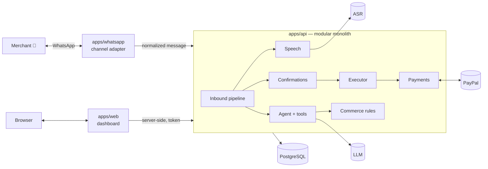

# Katale AI

**A multilingual, voice-first conversational commerce agent for WhatsApp and the web, with PayPal payments.**

Merchants send a voice note or text — _"Create an order for Sarah for 50 handmade baskets at $12
each and add $80 shipping"_ — and get back a precise, backend-calculated order summary. One
confirmation later, a PayPal payment link goes out; when the customer pays, the merchant is
notified and the dashboard updates.

> Status: the full commerce flow is verified over **real WhatsApp text** with a real LLM and **real
> PayPal Sandbox**: order → confirmation → payment link → payment → "Payment received" on WhatsApp.
> **Live at https://kataleai.space** (Docker Hub images → VM → Nginx Proxy Manager → HTTPS).
> **English voice notes** are verified in production (voice → draft → typed CONFIRM → PayPal → paid).
> **Luganda** voice is routed to Sunbird AI and is **experimental**. The dashboard requires a login.
> See [PROJECT_STATUS.md](PROJECT_STATUS.md), the [deployment guide](docs/deployment/docker-hub-vm.md),
> the [voice demo](docs/hackathon/voice-demo.md) and the [WhatsApp text demo](docs/hackathon/whatsapp-text-demo.md).

---

## Contents

1. [Overview](#1-overview)
2. [The problem](#2-the-problem)
3. [Product vision](#3-product-vision)
4. [Key features](#4-key-features)
5. [Architecture](#5-architecture)
6. [Repository structure](#6-repository-structure)
7. [Local setup](#7-local-setup)
8. [Environment variables](#8-environment-variables)
9. [Running individual services](#9-running-individual-services)
10. [WhatsApp QR authentication](#10-whatsapp-qr-authentication)
11. [Database](#11-database)
12. [PayPal Sandbox](#12-paypal-sandbox)
13. [AI configuration](#13-ai-configuration)
14. [Development workflow](#14-development-workflow)
15. [Testing](#15-testing)
16. [Security](#16-security)
17. [Known limitations](#17-known-limitations)
18. [Roadmap](#18-roadmap)

---

## 1. Overview

| Piece               | What it does                                                                                    |
| ------------------- | ----------------------------------------------------------------------------------------------- |
| **WhatsApp worker** | Receives text and voice notes via `whatsapp-web.js`, forwards them to the API, delivers replies |
| **API**             | Speech pipeline, AI agent with typed tools, commerce rules, confirmations, PayPal, webhooks     |
| **Dashboard**       | Revenue, orders, payments, customers, products, audit trail, and an agent console               |

## 2. The problem

Small merchants — especially across East Africa — sell through conversations, not storefronts.
Orders arrive as voice notes in mixed languages; totals are worked out by hand; payment links and
follow-ups are manual; nobody knows this week's revenue without scrolling through chats.

## 3. Product vision

Commerce that happens **where the merchant already talks**, in **their language**, by **voice**:

- Speak an order → get a correct, structured order and a PayPal payment link.
- Get told when customers pay. Ask "how much did I sell this week?" and get the real answer.
- Same brain on any channel: WhatsApp now; web chat, Telegram, mobile and voice later.
- AI that is helpful **and** safe with money: it proposes; code calculates; the merchant confirms.

More in [docs/hackathon/product-story.md](docs/hackathon/product-story.md).

## 4. Key features

- 🎙️ Voice notes → Whisper (English) or Sunbird AI (Luganda, experimental) → same agent as text, with original transcript, detected language, confidence and normalised text stored separately; unclear speech is read back and payments are only approved by typing the code
- 🤖 Provider-neutral LLM agent with Zod-typed tools (customers, products, inventory, quotes, orders, payment status, sales analytics)
- 🧮 Deterministic money: integer minor units, backend-only totals, AI-stated totals compared and overridden
- ✅ Confirmation-bound financial actions (merchant + conversation + payload hash + expiry + code)
- 💳 PayPal Orders v2 checkout links, capture, webhook signature verification, idempotent webhook handling
- 📊 Dashboard: revenue, outstanding, orders, payments, customers, products, activity/audit log, agent console
- 🔎 Correlation IDs across WhatsApp → speech → agent → confirmation → PayPal → webhook → notification
- 🌍 Multilingual-ready: Luganda/Swahili confirmation vocabulary, translation provider slot

## 5. Architecture



**The money path:** `message → AI interpretation → structured command → validation → deterministic pricing → policy → explicit confirmation → trusted PaymentService → PayPal`.

| Principle                       | How                                                                                                            |
| ------------------------------- | -------------------------------------------------------------------------------------------------------------- |
| WhatsApp is just a channel      | `whatsapp-web.js` lives only in `apps/whatsapp/src/whatsapp-adapter.ts`; the core sees `InboundChannelMessage` |
| AI interprets, code decides     | Tools are `read` / `write` / `propose`; nothing the model calls can move money                                 |
| Database is the source of truth | Prisma + Postgres; analytics and amounts come from queries, not the model                                      |
| Providers are swappable         | `ChatModel`, `SpeechToTextProvider`, `TranslationProvider`, `PayPalApi`, `ChannelSender`                       |

Deep dives: [system overview](docs/architecture/system-overview.md) ·
[agent design](docs/architecture/agent-design.md) ·
[financial safety](docs/architecture/financial-safety.md) ·
[WhatsApp](docs/architecture/whatsapp-integration.md) ·
[PayPal](docs/architecture/paypal-integration.md) ·
[ADRs](docs/architecture/decisions/README.md)

## 6. Repository structure

```
.
├── apps/
│   ├── api/                 Fastify API — composition root, HTTP, modules
│   │   └── src/
│   │       ├── container.ts       wires providers + services (the only place that picks implementations)
│   │       ├── app.ts             plugins, correlation IDs, raw body, routes
│   │       ├── http/              auth, validation, error mapping, dashboard scope
│   │       └── modules/
│   │           ├── agent/         inbound pipeline, tools, system prompt, confirmation executor
│   │           ├── payments/      trusted PaymentService (PayPal orchestration)
│   │           ├── paypal/        webhook service + routes, return/cancel pages
│   │           ├── notifications/ channel registry, WhatsApp gateway sender
│   │           ├── catalog/ orders/ dashboard/ health/
│   ├── whatsapp/            whatsapp-web.js worker (adapter, mapper, dedupe, API client, gateway)
│   └── web/                 Next.js 16 + Tailwind 4 dashboard
├── packages/
│   ├── commerce/            money, pricing, commands, state machines, policy, confirmations, services
│   ├── ai/                  ChatModel interface, OpenAI-compatible model, ToolRegistry, runAgent
│   ├── speech/              STT/language/translation interfaces, media validation, ffmpeg, pipeline
│   ├── paypal/              PayPal REST client, webhook helpers
│   ├── database/            Prisma schema, migrations, client, seed
│   ├── shared/              errors, logger, correlation context, channel contracts
│   └── config/              Zod-validated environment config
├── tests/                   integration tests (demo flow) + shared fakes
├── docs/                    architecture, ADRs, development, API, hackathon
├── docker/                  Dockerfiles (api, web, whatsapp)
├── scripts/dev-setup.sh     one-shot local setup
├── docker-compose.yml
└── .env.example
```

Workspace packages export TypeScript source (no per-package build step); apps bundle them
(`tsup` for Node apps, `transpilePackages` for Next.js).

## 7. Local setup

Prerequisites: Node ≥ 22.12, pnpm 9 (`corepack enable`), Docker (or your own Postgres).

```bash
./scripts/dev-setup.sh
```

```bash
pnpm dev
```

- Dashboard: <http://localhost:3000> — try **Agent console**
- API readiness: <http://localhost:4000/api/health/ready>

Full guide and troubleshooting: [docs/development/local-setup.md](docs/development/local-setup.md).

## 8. Environment variables

One root `.env` for every app, validated at startup (`packages/config`). Full annotated list in
[`.env.example`](.env.example).

| Group     | Variables                                                                                                                                                                                          | Required for      |
| --------- | -------------------------------------------------------------------------------------------------------------------------------------------------------------------------------------------------- | ----------------- |
| Core      | `NODE_ENV`, `LOG_LEVEL`, `DATABASE_URL`                                                                                                                                                            | everything        |
| API       | `API_PORT`, `API_PUBLIC_URL`, `API_AUTH_TOKEN`, `INTERNAL_SERVICE_TOKEN`, `CORS_ORIGINS`, `RATE_LIMIT_MAX`                                                                                         | API               |
| AI        | `AI_PROVIDER`, `AI_BASE_URL`, `AI_API_KEY`, `AI_MODEL`, `AI_TIMEOUT_MS`                                                                                                                            | agent replies     |
| Speech    | `VOICE_NOTES_ENABLED`, `VOICE_MAX_DURATION_SECONDS`, `VOICE_MIN_CONFIDENCE`, `STT_*`, `SUNBIRD_API_URL`, `SUNBIRD_API_KEY`, `TRANSLATION_PROVIDER`, `VOICE_TRANSLATE_LANGUAGES`, `MEDIA_MAX_BYTES` | voice notes       |
| PayPal    | `PAYPAL_ENV`, `PAYPAL_CLIENT_ID`, `PAYPAL_CLIENT_SECRET`, `PAYPAL_WEBHOOK_ID`, `PAYPAL_BRAND_NAME`, `PAYPAL_WEBHOOK_SKIP_VERIFICATION`                                                             | payments          |
| Policy    | `DEFAULT_CURRENCY`, `CONFIRMATION_TTL_SECONDS`, `MAX_PAYMENT_REQUEST_AMOUNT`                                                                                                                       | —                 |
| WhatsApp  | `WHATSAPP_API_BASE_URL`, `WHATSAPP_SESSION_DIR`, `WHATSAPP_CLIENT_ID`, `WHATSAPP_HEADLESS`, `WHATSAPP_CHROME_PATH`, `WHATSAPP_GATEWAY_PORT/HOST/URL`                                               | worker            |
| Seed      | `SEED_MERCHANT_WHATSAPP_ID`                                                                                                                                                                        | WhatsApp operator |
| Dashboard | `API_BASE_URL` (+ `API_AUTH_TOKEN`, server-side only), `DASHBOARD_USERNAME`, `DASHBOARD_PASSWORD`, `DASHBOARD_SESSION_HOURS`                                                                       | web               |

Optional providers degrade gracefully — the API starts without AI, speech, PayPal or WhatsApp and
`/api/health/ready` reports what is missing.

## 9. Running individual services

| Command             | Service                            |
| ------------------- | ---------------------------------- |
| `pnpm dev`          | API (:4000) + dashboard (:3000)    |
| `pnpm dev:api`      | API only                           |
| `pnpm dev:web`      | Dashboard only                     |
| `pnpm dev:whatsapp` | WhatsApp worker (gateway on :4100) |
| `pnpm db:studio`    | Prisma Studio                      |

Docker (local): `docker compose --profile app up --build` (API + dashboard + Postgres), add `--profile whatsapp` for the worker.

**Production:** build locally → push immutable tags to Docker Hub → pull on the VM → Docker Compose →
Nginx Proxy Manager → HTTPS:

```bash
KATALE_IMAGE_NAMESPACE=yigagilbert PLATFORMS=linux/amd64 ./scripts/release-images.sh
```

```bash
ssh deploy@217.65.145.220 'cd /opt/apps/katale-ai && ./deployment/vm-deploy.sh <tag>'
```

Full guide (env, migrations, NPM, webhook, backups, rollback): [docs/deployment/docker-hub-vm.md](docs/deployment/docker-hub-vm.md).

## 10. WhatsApp QR authentication

1. Use a **dedicated number** for the Katale AI bot (not your personal main WhatsApp).
2. `pnpm dev:whatsapp` → scan the QR in the terminal from the bot phone: _Settings → Linked devices → Link a device_.
   If Chrome fails to launch, set `WHATSAPP_CHROME_PATH` to an installed Chrome.
3. The session is saved in `.data/whatsapp-session` (git-ignored); restarts don't need a new QR. Delete it to re-link.
4. Message the bot from the merchant's WhatsApp. Katale AI replies with **"Your WhatsApp ID: …"**
   (often a linked ID like `201234567890123@lid`, sometimes `256700000000@c.us`). Register it:
   `pnpm operator:add <whatsappId> "Owner name"`.
5. Voice notes are processed when `VOICE_NOTES_ENABLED=true` (needs `STT_API_KEY`; `SUNBIRD_API_KEY` adds Luganda);
   otherwise they get "coming soon". Other media get a polite reply.

Demo script: [docs/hackathon/whatsapp-text-demo.md](docs/hackathon/whatsapp-text-demo.md).
Setup details, recovery, limitations and the Cloud API migration path:
[docs/architecture/whatsapp-integration.md](docs/architecture/whatsapp-integration.md).

## 11. Database

PostgreSQL via Prisma 7 (`packages/database`). Money is stored as integer minor units.

```bash
pnpm db:up        # Postgres in Docker on localhost:5433
pnpm db:migrate   # create/apply migrations (dev)
pnpm db:deploy    # apply committed migrations (CI/prod)
pnpm db:seed      # Kampala Crafts demo merchant (fictional)
pnpm db:studio
```

Core models: `Merchant`, `MerchantOperator`, `Customer`, `Product`, `Order`, `OrderItem`, `Payment`,
`Conversation`, `Message`, `ActionConfirmation`, `AuditEvent`, `WebhookEvent`
([schema](packages/database/prisma/schema.prisma)).

## 12. PayPal Sandbox

1. Create a Sandbox REST app at <https://developer.paypal.com/dashboard/applications/sandbox>.
2. Set `PAYPAL_CLIENT_ID` / `PAYPAL_CLIENT_SECRET`, keep `PAYPAL_ENV=sandbox`.
3. Pay links with the auto-created Sandbox **personal** account. The buyer's return to
   `API_PUBLIC_URL/api/paypal/return` captures the payment — works locally without a tunnel.
4. For webhooks: tunnel the API (`ngrok http 4000` / `cloudflared`), set `API_PUBLIC_URL`, register
   `…/api/paypal/webhooks`, set `PAYPAL_WEBHOOK_ID`.

PayPal does not support UGX/KES/NGN — price PayPal requests in a supported currency.
Check credentials with `pnpm paypal:check`. Full walkthrough (test buyer, webhooks, tunnel, troubleshooting):
[docs/development/real-services.md](docs/development/real-services.md). API details and verified
findings: [docs/architecture/paypal-integration.md](docs/architecture/paypal-integration.md).

## 13. AI configuration

Any OpenAI-compatible endpoint works out of the box:

```bash
# OpenAI
AI_BASE_URL=https://api.openai.com/v1
AI_MODEL=gpt-4.1-mini
# OpenRouter / Groq / Together / local Ollama: change AI_BASE_URL + AI_MODEL
```

The model must support native tool calling — check with `pnpm ai:check`.
Speech uses `/audio/transcriptions` (`STT_*`, e.g. `whisper-1`). Other providers (Anthropic, Gemini,
Sunbird AI, MMS) implement `ChatModel` / `SpeechToTextProvider` / `TranslationProvider` and are wired
in `apps/api/src/container.ts`. Tools and prompts: [agent design](docs/architecture/agent-design.md).

## 14. Development workflow

- Strict TypeScript everywhere; ESM; Zod at every boundary.
- Business logic in `packages/*`; apps compose. Add an agent capability with one `defineTool(...)`.
- New sensitive action → `ConfirmationAction` + executor handler + `propose` tool.
- Before pushing: `pnpm verify` (lint → format check → typecheck → tests → build).
- Record significant decisions as ADRs; update [PROJECT_STATUS.md](PROJECT_STATUS.md).

## 15. Testing

```bash
pnpm test               # unit + HTTP tests (no services needed)
pnpm test:integration   # full demo flow against Postgres (fake PayPal + scripted LLM)
pnpm verify
# Opt-in, real services (Sandbox only, never run by verify/CI):
pnpm test:external      # real PayPal Sandbox + real LLM tool calling
pnpm paypal:smoke       # create a $1 Sandbox order; then: pnpm paypal:smoke capture <id>
```

Unit tests are co-located (`*.test.ts`). The integration test
[`tests/integration/demo-flow.test.ts`](tests/integration/demo-flow.test.ts) covers: drafting with
backend totals (overriding a wrong AI total), duplicate message detection, wrong/right/duplicate
confirmation codes, PayPal checkout creation, webhook capture, idempotent redelivery, payment
notifications, sales summary, and the audit trail.

## 16. Security

- No secrets in code; `.env` is git-ignored; config validated at startup.
- Dashboard login page with an HMAC-signed HttpOnly session cookie; every page and server action checks it; login attempts are throttled.
- Dashboard → API token is server-side only; workers use a separate internal token; constant-time comparison.
- Voice: duration checked before any STT call; spoken "confirm" never approves a payment; voice never creates customers silently.
- Only registered `MerchantOperator` identities can drive a merchant.
- LLM has no path to payment execution; confirmations are bound, hashed, expiring and atomically claimed.
- PayPal webhook signatures verified with the raw body; webhook events stored once (idempotent).
- PayPal-Request-Id idempotency keys on create/capture.
- Media: MIME allow-list, size limits before decode, magic-byte check, in-memory processing.
- Rate limiting, Helmet, CORS allow-list, body limits, typed errors without stack traces.
- Structured logs with correlation IDs and redaction of tokens, keys and media payloads.
- WhatsApp session data (`.data/`, `.wwebjs_*`) is git-ignored.

## 17. Known limitations

- `whatsapp-web.js` is unofficial and may break or get numbers restricted — demo/dev only.
- Verified live: WhatsApp text and English voice, PayPal Sandbox (incl. webhooks), LLM. Luganda voice is experimental (see [voice commerce](docs/architecture/voice-commerce.md#known-luganda-limitations)).
- Payment links paid **on a phone** need a public `API_PUBLIC_URL` (tunnel) for the return/webhook to reach the API.
- Dashboard auth is one shared login (single-tenant merchant shortcut); no per-merchant users yet.
- Luganda vocabulary/number list is a starter set, not validated with native speakers; no TTS replies.
- Invoicing, refunds and subscriptions: not implemented beyond PayPal client methods.
- Dashboard refreshes on navigation (no live push); tables are simple (AG Grid-ready).
- ASR + LLM run synchronously inside the request (fine for demo scale).

## 18. Roadmap

1. ~~Live PayPal Sandbox + LLM run of the core flow~~ ✅ · ~~WhatsApp text channel live~~ ✅ — next: deployed demo with webhooks
2. ~~Voice notes (English) + Sunbird AI Luganda ASR~~ ✅ (Luganda experimental) — next: native-speaker validation; spoken replies (TTS)
3. PayPal invoicing and refunds through the confirmation mechanism
4. AG Grid for orders, customers, transactions, inventory; AI business insights
5. Per-merchant users and multi-merchant onboarding (a single dashboard login exists)
6. Official WhatsApp Cloud API adapter; web chat and Telegram channels
7. Background jobs for slow work (ASR/LLM) and live dashboard updates
