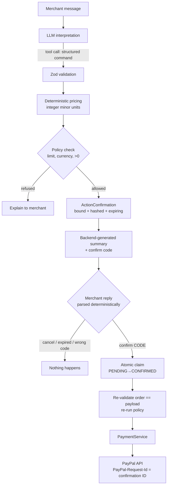
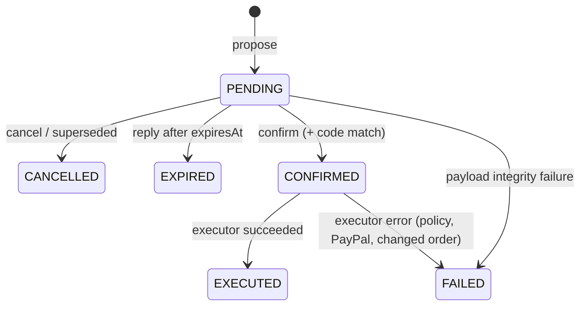

# Financial safety

> AI may recommend financial actions. The backend validates them. The merchant confirms them.
> Then — and only then — the payment layer executes them.

## The money path

## Guarantees and where they are enforced

| Guarantee                                        | Enforced by                                                            |
| ------------------------------------------------ | ---------------------------------------------------------------------- |
| The LLM cannot call PayPal                       | No tool has access to `PaymentService`; tools are `read/write/propose` |
| Totals come from code, not the model             | `calculateOrderTotals`, `OrderService.price`                           |
| No silent rounding                               | `toMinorUnits` rejects excess precision                                |
| The merchant sees exactly what will be charged   | Deterministic `formatOrderSummary` replaces the model's reply          |
| "yes" alone never approves anything              | Every action needs its code (`CONFIRM 4821`); one pending per chat     |
| Confirmation is bound to its payload             | `payloadHash` (SHA-256 canonical JSON) checked at claim                |
| Order can't change between summary and execution | Executor compares DB order to confirmed payload                        |
| Double "confirm" can't double-charge             | Conditional `updateMany(status=PENDING)` claim                         |
| Retried PayPal calls don't duplicate             | `PayPal-Request-Id` = confirmation ID / `capture-<paymentId>`          |
| Repeated webhooks don't duplicate side effects   | `WebhookEvent(provider,eventId)` unique + status machine               |
| Out-of-order webhooks can't regress status       | `canTransitionPayment` / `assertOrderTransition`                       |
| Forged webhooks are rejected                     | PayPal `verify-webhook-signature` with the raw body                    |
| Unknown WhatsApp users can't create requests     | `MerchantOperator` allow-list                                          |
| Limits                                           | `MAX_PAYMENT_REQUEST_AMOUNT`, PayPal currency allow-list               |
| Everything is traceable                          | `AuditEvent` rows with correlation IDs                                 |

## Confirmation lifecycle

## Development escape hatches (and why they're fenced)

- `PAYPAL_WEBHOOK_SKIP_VERIFICATION=true` is honoured **only** when `NODE_ENV=development`, and
  logs a warning on every webhook.
- There is no "auto-confirm" switch. Demos confirm like real users do.

## Not yet covered

- Refunds, invoice sending and capture of authorisations have `ConfirmationAction` values reserved
  but no executor handlers or tools yet.
- Per-merchant limits, velocity checks and anomaly detection.
- Multi-user merchant accounts with roles beyond `OWNER`/`STAFF`.

## Claims and customer content

**Replies are checked against tools.** Model text that claims an action no tool did this turn, contains an approval code or draws an order summary isn't sent (`claim-guard.ts`). On the merchant path the model gets one retry if nothing has changed yet, then the plain truth and the real pending summary go out. Draft changes go through `update_draft_order`, which recalculates and issues a new code, so the old one stops working. A customer's placed order can't be edited this way.

**Customer words are data.** Alerts are stored as `kind: ALERT` and left out of the merchant agent's history. A bare "yes" straight after an alert does nothing and uses no model. Forwarded text is shown on one line with formatting removed, so it can't pass as a Katale alert.

**Recipients.** A WhatsApp profile name is the customer's own claim. A private message or a name match on one needs the number's digits in the merchant's own typed words, or a reply to that customer's alert. Several matches are refused, and an exact profile-name match can't outrank a customer the merchant saved.

**Cancelling.** A bare "no" to a payment request leaves a customer's placed order open and says so. Cancelling it needs `cancel order ORD-…` and then `CANCEL ORDER <code>`, is owner-only, and tells the customer. Customers holding a payment link are told too.

**Stock.** `adjust_stock` won't record a restock unless the merchant's own words say goods arrived, so "order 20 more" can't invent stock.

**Currencies.** Checkout stops before asking for details if PayPal can't take the shop's currency, and says why. There is no conversion: that needs an approved exchange-rate and settlement design.
