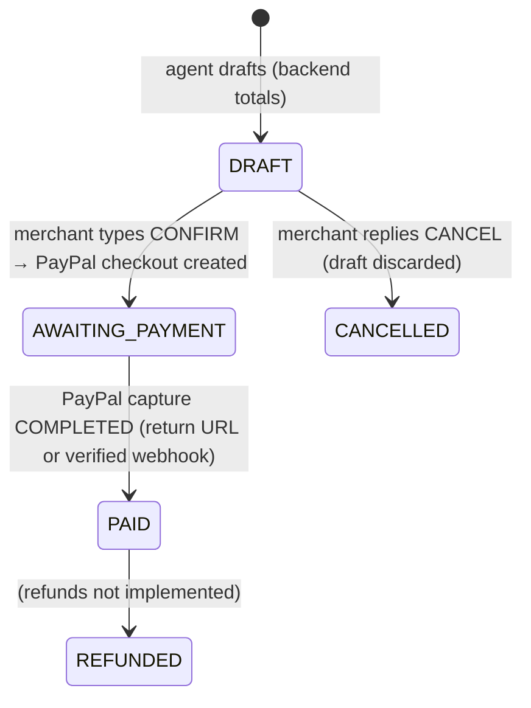

# Order lifecycle and responsible agentic commerce

## Responsible agentic commerce: who does what

| Step                       | Who           | What                                                                     | Enforced in                                                            |
| -------------------------- | ------------- | ------------------------------------------------------------------------ | ---------------------------------------------------------------------- |
| 1. **AI interprets**       | LLM           | Natural language (typed or transcribed) → a structured tool call         | `runAgent`, tool schemas (Zod)                                         |
| 2. **Backend verifies**    | Commerce core | Customer, product, price, quantity, totals, currency, limits             | `OrderService.price`, `calculateOrderTotals`, `evaluatePaymentRequest` |
| 3. **Merchant approves**   | Merchant      | Types `CONFIRM <code>` (bound to the exact payload, expires, single use) | `ConfirmationService.claim`                                            |
| 4. **PayPal executes**     | PayPal        | Checkout order, buyer approval, capture                                  | `PaymentService` (idempotent `PayPal-Request-Id`)                      |
| 5. **Audit trail records** | System        | Who/what/when for each step, under one trace ID                          | `AuditService`, Activity page                                          |

The LLM may interpret, ask clarifying questions, choose tools and explain results. It cannot
calculate authoritative totals, create customers or products from a misheard voice note, read
payment state from the conversation, execute payments or bypass confirmation.

## Order states

| Status             | Dashboard label  | Meaning                                                                                                       |
| ------------------ | ---------------- | ------------------------------------------------------------------------------------------------------------- |
| `DRAFT`            | Draft            | Built and priced by the backend; waiting for the merchant's `CONFIRM` code (the "awaiting confirmation" step) |
| `AWAITING_PAYMENT` | Awaiting payment | PayPal checkout link sent; buyer hasn't paid                                                                  |
| `PAID`             | Paid             | PayPal reported the capture `COMPLETED`                                                                       |
| `CANCELLED`        | Cancelled        | The merchant discarded the draft with `CANCEL` before any payment request                                     |
| `REFUNDED`         | Refunded         | Reserved; refunds are not implemented                                                                         |

There is no separate "awaiting confirmation" status: the pending `ActionConfirmation` carries it,
so the state machine stays small. A draft whose confirmation expires stays `DRAFT` and can be sent
again ("request payment for ORD-…").

## Payment states

| Status      | Label          | Set by                                                              |
| ----------- | -------------- | ------------------------------------------------------------------- |
| `CREATED`   | Awaiting buyer | Checkout order created at PayPal                                    |
| `APPROVED`  | Approved       | Buyer approved; capture pending at PayPal                           |
| `COMPLETED` | Completed      | Capture `COMPLETED` (sets the order `PAID`, sends one notification) |
| `FAILED`    | Failed         | PayPal declined, or the checkout could not be created               |

Only PayPal moves a payment forward: the buyer's return URL triggers a server-side capture, and
verified webhooks (`CHECKOUT.ORDER.APPROVED`, `PAYMENT.CAPTURE.*`) are processed once. A buyer who
cancels on PayPal changes nothing: the order stays `AWAITING_PAYMENT` and the original link still works.

## Duplicates and retries

| Situation                                    | Behaviour                                                                                                   |
| -------------------------------------------- | ----------------------------------------------------------------------------------------------------------- |
| WhatsApp delivers the same message twice     | Ignored (unique provider message ID); no reply                                                              |
| Merchant types the same `CONFIRM` code again | "That payment request was already created…" with the current status and link; no second PayPal order        |
| Two `CONFIRM`s at the same moment            | One claims (atomic update); the other gets "still working on that"                                          |
| PayPal unavailable when confirming           | "I couldn't create the payment request right now. Your order has not been charged." The order stays a draft |
| Return URL and webhook race                  | One capture, one status change, one notification                                                            |
