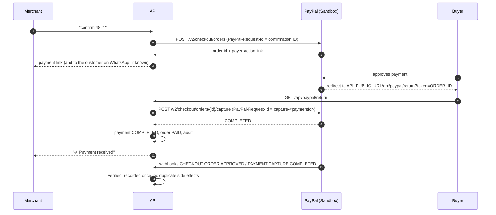

# PayPal integration

PayPal is the system's payment rail. All PayPal traffic goes through `@vca/paypal`
(`PayPalClient`), called only by the API's `PaymentService`, `ShipmentService` and `DisputeService`
— after validation and merchant confirmation (`CONFIRM` / `SHIP` / `SUBMIT`) for outgoing
requests, or after signature verification for webhooks.

APIs used: Orders v2 (checkout, capture, **tracking**), Disputes v1 (**list, details,
provide-evidence**; `require-evidence` in Sandbox test tooling only), Webhooks v1 (verify signature,
manage subscriptions). Shipment: [shipment.md](shipment.md). Disputes: [disputes.md](disputes.md).

## What is implemented and verified

| Capability                         | Where                                                 | Verified against real Sandbox (2026-10-05)                                            |
| ---------------------------------- | ----------------------------------------------------- | ------------------------------------------------------------------------------------- |
| OAuth2 client credentials + cache  | `PayPalClient.checkCredentials/accessToken`           | ✅ `pnpm paypal:check`, external tests                                                |
| Orders v2 create (checkout link)   | `createCheckoutOrder`                                 | ✅ status `PAYER_ACTION_REQUIRED`, `payer-action` link                                |
| Create idempotency                 | `PayPal-Request-Id` = confirmation ID                 | ✅ same request ID → same PayPal order                                                |
| Orders v2 get                      | `getOrder`                                            | ✅                                                                                    |
| Capture before approval            | `captureOrder`                                        | ✅ rejected with `ORDER_NOT_APPROVED`                                                 |
| Buyer checkout → return → capture  | `/api/paypal/return` → `captureApproved`              | ✅ ORD-CTABAZ, $140.00 captured, order `PAID`                                         |
| Duplicate capture protection       | local status + request ID + already-captured sync     | ✅ replays: no 2nd capture, no 2nd notification                                       |
| Webhook signature verification API | `verifyWebhookSignature` (raw body spliced)           | ✅ forged event → `FAILURE` → 401                                                     |
| Webhook delivery + event handling  | `PayPalWebhookService`                                | ✅ live in production since 2026-10-06 (payment events)                               |
| Orders v2 tracking                 | `addTracking` (`POST /v2/checkout/orders/{id}/track`) | See [PROJECT_STATUS.md](../../PROJECT_STATUS.md); contract from PayPal's OpenAPI spec |
| Disputes v1 list / details         | `listDisputes`, `getDispute`                          | ✅ list = 200 with the Sandbox app (scopes `disputes/read-seller`, `update-seller`)   |
| Disputes v1 provide-evidence       | `provideDisputeEvidence` (multipart `input` part)     | See [PROJECT_STATUS.md](../../PROJECT_STATUS.md)                                      |
| Invoicing v2 create draft / send   | `createDraftInvoice`, `sendInvoice`                   | ❌ not used yet                                                                       |
| Refunds, subscriptions             | —                                                     | ❌ not implemented                                                                    |

## Findings from validating against PayPal (2026-10-05)

Request and response shapes in the repository matched PayPal's current Orders v2 documentation:
`api-m.sandbox.paypal.com`, `POST /v1/oauth2/token` (Basic auth, `grant_type=client_credentials`),
`POST /v2/checkout/orders` with `intent: CAPTURE`, `purchase_units[].amount.breakdown`, items with
string quantities, and `payment_source.paypal.experience_context` (`return_url`, `cancel_url`,
`user_action: PAY_NOW`, `shipping_preference: NO_SHIPPING`). The response is `PAYER_ACTION_REQUIRED`
with a `payer-action` link; capture is `POST …/capture` with `{}`. Webhook verification posts the
event back unchanged. Discrepancies found and fixed:

| #   | Finding                                                                                                                                                                      | Impact before                                                    | Fix                                                                                                                             |
| --- | ---------------------------------------------------------------------------------------------------------------------------------------------------------------------------- | ---------------------------------------------------------------- | ------------------------------------------------------------------------------------------------------------------------------- |
| 1   | OAuth errors use the RFC 6749 shape `{error, error_description}`, not `{name, message}`                                                                                      | Bad credentials surfaced as `HTTP_401: request failed`           | Parse both shapes → `invalid_client: Client Authentication failed`                                                              |
| 2   | Revoked or expired cached tokens return 401 on API calls                                                                                                                     | One failed request until the token expired                       | Refresh the token once and resend with the same `PayPal-Request-Id`                                                             |
| 3   | Repeating a capture of a COMPLETED order with a **new** request ID returns **200 with the existing capture** (observed), while PayPal documents `422 ORDER_ALREADY_CAPTURED` | None (no double charge), but neither path was handled explicitly | Both handled: a COMPLETED capture result is idempotent via `markCompleted`; `ORDER_ALREADY_CAPTURED` → `GET` the order and sync |
| 4   | A capture can come back `PENDING`/`DECLINED`                                                                                                                                 | The return page said "Thank you" regardless                      | Explicit outcomes `completed` / `pending` / `failed` / `already_handled`, with matching return pages                            |
| 5   | The verify API rejects malformed input (e.g. `webhook_id` must match `^[a-zA-Z0-9]+$`) with **400**                                                                          | Forged webhooks got 502, inviting retries                        | 4xx from verification → 401 invalid signature; 5xx still propagates                                                             |
| 6   | PayPal's order status was not stored                                                                                                                                         | Dashboard could not show PayPal's view                           | `Payment.providerStatus` (+ `correlationId` for tracing)                                                                        |
| 7   | Webhook simulator mock events cannot be verified via the API (PayPal docs)                                                                                                   | Possible confusion when testing                                  | Documented in `docs/development/real-services.md`                                                                               |

**Account finding:** the first Sandbox app's seller account returned
`PAYEE_ACCOUNT_LOCKED_OR_CLOSED` at checkout ("The merchant isn't able to accept PayPal payments").
Order creation still succeeds in that state; the failure only appears at buyer checkout.
Fix: create a **US Sandbox Business account** and a REST app linked to it. `pnpm paypal:smoke`
prints a checkout link that catches this early.

**Operational finding:** restart the API after changing PayPal credentials. Orders are scoped to the
app that created them, and other apps get `RESOURCE_NOT_FOUND`. A stale API process still holding
port 4000 kept using the old credentials during testing.

## Payment flow

Capture happens on whichever arrives first (return redirect or `CHECKOUT.ORDER.APPROVED` webhook);
both paths are idempotent ([ADR 0007](decisions/0007-capture-on-return-and-webhook.md)). Because the return URL is opened in the buyer's browser, **the local
demo works without a public tunnel** when the buyer completes payment on the same machine.
Webhooks need a public URL.

## Sandbox setup

Step-by-step guide, including the test buyer, webhooks and tunnels:
[docs/development/real-services.md](../development/real-services.md). Summary:

1. Log in to <https://developer.paypal.com/> → **Apps & Credentials** → _Sandbox_ → **Create App** (Merchant).
2. Copy **Client ID** / **Secret** → `PAYPAL_CLIENT_ID`, `PAYPAL_CLIENT_SECRET`. Keep `PAYPAL_ENV=sandbox`.
3. **Sandbox accounts:** use the auto-created _Personal_ account (buyer) to pay checkout links.
4. **Webhooks (optional for local demo, required for production):**
   - Expose the API: e.g. `cloudflared tunnel --url http://localhost:4000` or `ngrok http 4000`.
   - Set `API_PUBLIC_URL` to the tunnel URL (restart the API).
   - Register it: `pnpm paypal:webhook register https://<host>/api/paypal/webhooks` (subscribes
     `CHECKOUT.ORDER.APPROVED`, `PAYMENT.CAPTURE.COMPLETED`, `PAYMENT.CAPTURE.DECLINED`,
     `PAYMENT.CAPTURE.REFUNDED`, `PAYMENT.CAPTURE.REVERSED` — v2 names; `…DENIED` is v1-only).
   - Put the printed ID in `PAYPAL_WEBHOOK_ID`. Production uses `https://kataleai.space/api/paypal/webhooks`.
5. Check: `curl localhost:4000/api/health/ready` shows `"paypal": "sandbox"`.

## Currency note (important for Ugandan merchants)

PayPal does **not** support UGX, KES or NGN for payments. `evaluatePaymentRequest` refuses
unsupported currencies with a clear message. Merchants should price PayPal requests in a
supported currency (USD in the seed data). Local-currency display with FX conversion is a roadmap item.

## Idempotency keys

| Operation        | `PayPal-Request-Id`                                   | Effect                                                                                       |
| ---------------- | ----------------------------------------------------- | -------------------------------------------------------------------------------------------- |
| Create order     | confirmation ID                                       | A retried confirmation can't create a second PayPal order                                    |
| Capture          | `capture-<paymentId>`                                 | Return URL + webhook racing capture once                                                     |
| Add tracking     | none (PayPal dedupes on capture ID + tracking number) | A repeat returns the existing tracker; Katale also refuses duplicates locally                |
| Provide evidence | none                                                  | One `DisputeResponse` per SUBMIT confirmation (unique); a repeated SUBMIT never calls PayPal |
| Invoice create   | caller-provided                                       | —                                                                                            |

## Status mapping

| Event / result                                    | Payment              | Order                                       |
| ------------------------------------------------- | -------------------- | ------------------------------------------- |
| Checkout order created                            | `CREATED`            | `DRAFT → AWAITING_PAYMENT`                  |
| `CHECKOUT.ORDER.APPROVED`                         | `APPROVED` → capture | —                                           |
| Capture `COMPLETED` / `PAYMENT.CAPTURE.COMPLETED` | `COMPLETED`          | `AWAITING_PAYMENT → PAID`                   |
| `PAYMENT.CAPTURE.DENIED/DECLINED`                 | `FAILED`             | unchanged                                   |
| `PAYMENT.CAPTURE.REFUNDED/REVERSED`               | `REFUNDED`           | unchanged (roadmap: `REFUNDED`)             |
| Tracking accepted (merchant `SHIP`)               | unchanged            | `fulfillmentStatus NOT_SHIPPED → SHIPPED`   |
| `CUSTOMER.DISPUTE.CREATED/UPDATED/RESOLVED`       | unchanged            | unchanged; `Dispute` row synced from PayPal |

Webhook subscriptions: `CHECKOUT.ORDER.APPROVED`, `PAYMENT.CAPTURE.COMPLETED/DECLINED/REFUNDED/REVERSED`,
`CUSTOMER.DISPUTE.CREATED/UPDATED/RESOLVED` (`pnpm paypal:webhook sync <url>`).
