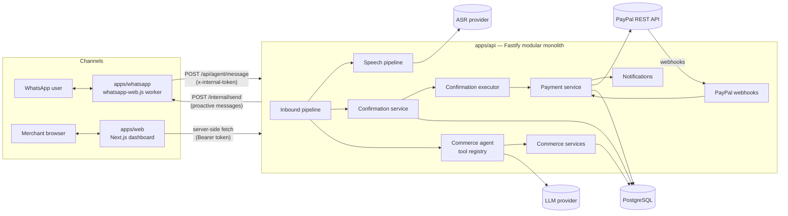
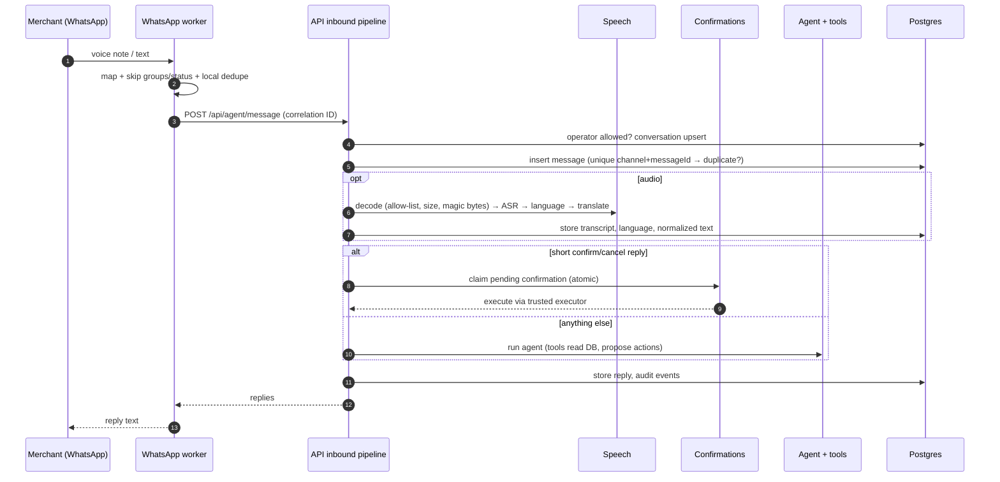

# System overview

A voice-first conversational commerce agent. Merchants talk (or type) to an assistant on
WhatsApp or the web dashboard; the system turns that into validated orders and PayPal payment
requests, then tracks payment to completion.

## Components

| Layer       | Lives in                               | Responsibility                                                             |
| ----------- | -------------------------------------- | -------------------------------------------------------------------------- |
| Channel     | `apps/whatsapp`, `apps/web`            | Native I/O only; normalise to `InboundChannelMessage`                      |
| API / HTTP  | `apps/api/src/http`, `modules/*`       | Auth, validation, routing, composition root                                |
| AI          | `packages/ai`                          | Provider-neutral chat model + tool registry + agent loop                   |
| Speech      | `packages/speech`                      | Media validation, normalisation, ASR, language ID, translation             |
| Commerce    | `packages/commerce`                    | Money, pricing, commands, state machines, policy, confirmations, analytics |
| Payments    | `packages/paypal` + `modules/payments` | PayPal REST client; trusted payment orchestration                          |
| Persistence | `packages/database`                    | Prisma schema, migrations, client, seed — **source of truth**              |
| Shared      | `packages/shared`, `packages/config`   | Errors, logging, correlation context, channel contracts, env validation    |

Dependency direction: `apps → packages`, and inside packages `commerce → database, shared`;
`ai`, `speech`, `paypal` depend only on `shared`. `commerce` never imports `paypal` or `ai` —
the API wires them together.

## Inbound message lifecycle

## Observability

- Every request gets a **correlation ID** (`x-correlation-id`, reused if supplied by the worker).
  It is stored in an `AsyncLocalStorage` context and automatically added to every log line
  (pino `mixin`), every `Message`, `AuditEvent` and `ActionConfirmation` row.
- Trace a demo end-to-end: WhatsApp message → `Message.correlationId` → `AuditEvent`s
  (`speech.transcribed`, `agent.intent_interpreted`, `order.drafted`, `confirmation.*`,
  `payment.*`) → the dashboard Activity page.
- Logs redact authorization headers, tokens, API keys and base64 media (`REDACT_PATHS`).

## Security summary

See [financial-safety.md](financial-safety.md) for the money path. In addition:

- Service-to-service auth with constant-time token comparison; the dashboard token never reaches the browser.
- Only allow-listed `MerchantOperator` identities can drive a merchant; unknown senders are ignored.
- Zod validation on every input; typed `AppError`s map to stable HTTP errors (no stack traces leaked).
- Rate limiting (`@fastify/rate-limit`), Helmet headers, CORS allow-list, body limits.
- Media: MIME allow-list, size check before decode, strict base64, magic bytes; processed in memory.
- PayPal webhooks: signature verification + idempotent event store.
