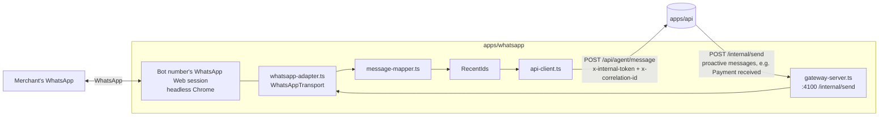

# WhatsApp integration

Katale AI uses [`whatsapp-web.js`](https://wwebjs.dev/guide/) for development and the hackathon
demo. It is isolated so it can be replaced by the official **WhatsApp Cloud API** later
([ADR 0002](decisions/0002-whatsapp-behind-adapter.md)).

**Status (2026-10-05): verified end to end with a real WhatsApp account, text only.** See
[Verified behaviour](#verified-behaviour-2026-10-05).

## Process layout



| File                  | Role                                                                                      |
| --------------------- | ----------------------------------------------------------------------------------------- |
| `whatsapp-adapter.ts` | **Only** file importing `whatsapp-web.js`: `LocalAuth`, QR, events, send.                 |
| `message-mapper.ts`   | Pure mapping to `InboundChannelMessage`: message-ID derivation, skips, unsupported types. |
| `dedupe.ts`           | Bounded recently-seen set (the same message can arrive via two events).                   |
| `api-client.ts`       | Forwards to the API with `x-internal-token` and a per-message correlation ID.             |
| `gateway-server.ts`   | Internal HTTP endpoint for proactive messages (payment received, payment links).          |

The worker contains no business logic: no LLM, database or PayPal calls. Every reply, including
"not registered" and "coming soon", is decided by the API.

## Setup

### 1. Use a dedicated bot number

Link a **dedicated WhatsApp number** for Katale AI (a spare SIM or a WhatsApp Business test
number), never a personal main account. The merchant messages that number from their own WhatsApp.

### 2. Chrome / Puppeteer

Puppeteer downloads its own Chrome on `pnpm install`. If launch fails (e.g. `Failed to launch the
browser process … dlopen … Framework`), point the worker at an installed browser:

```bash
WHATSAPP_CHROME_PATH=/Applications/Google Chrome.app/Contents/MacOS/Google Chrome
```

`WHATSAPP_HEADLESS=true` (default) runs it invisibly. The Docker image uses the distro Chromium.

### 3. QR authentication (`LocalAuth`)

```bash
pnpm dev:whatsapp
```

1. Open the dashboard → **WhatsApp** (status, live QR, Reconnect, Unlink device), or read the QR
   printed in the terminal (`WHATSAPP_PRINT_QR=true`, the default; set `false` in production so the
   pairing code never reaches the logs). It refreshes every ~20 s.
2. On the **bot phone**: WhatsApp → Settings → **Linked devices → Link a device** → scan.
3. The log shows `WhatsApp authenticated (session saved)` then `WhatsApp client ready`.
4. The session is stored in `WHATSAPP_SESSION_DIR/session-<WHATSAPP_CLIENT_ID>`
   (default `.data/whatsapp-session/session-katale-dev`), which is **git-ignored** (`.data/`, `.wwebjs_*`).
   Restarts reuse it, with no QR (verified: ready about 4 s after restart).

### 4. Register admin numbers

Only **active admins** can use Katale AI or receive business information. Each number belongs to
**exactly one** merchant. Manage them in the dashboard → **Admins**:

- **Add** a name and WhatsApp number in any format (`+256 772 123456`, `0772 123456`). It is
  validated and stored in E.164 (`+256772123456`); local numbers use `DEFAULT_PHONE_REGION` (`UG`).
- **Send test** checks the number is on WhatsApp and delivers a short message.
- **Edit** the name, number, and whether the admin gets **business reports** and **stock/dispute alerts**.
- **Deactivate** keeps the record but blocks commands and notifications; **Remove** deletes it.
  Every change is audited (numbers are masked in the audit trail).

Matching: a message is accepted when its sender is the admin's `…@c.us` chat ID, a linked ID
(`…@lid`) already learned for that admin, or — newer WhatsApp accounts — a linked ID whose phone the
worker resolves with `getContactLidAndPhone`. The linked ID is then remembered on the admin.

Everyone else — customers, deactivated admins, strangers — gets the same generic welcome and
nothing else (no agent, no tools, no data, no database lookups):

> Hello! 👋 Welcome to Katale AI. Our team will get back to you as soon as they're available.

It contains no business details or IDs and doesn't reveal whether the number is known. Each sender
gets it at most once per `UNAUTHORIZED_REPLY_COOLDOWN_HOURS` (default 24; in-memory, so a restart
resets it). Approval codes and voice notes from these numbers are ignored. Incoming calls are
declined with a neutral "this number can't take calls" message.

CLI alternative: `pnpm operator:add <whatsappId> "Owner name"` (or `SEED_MERCHANT_WHATSAPP_ID` + `pnpm db:seed`).

**ID formats.** WhatsApp identifies senders either by phone number or by a privacy-preserving linked ID:

| Format                       | Example               | Notes                                                                                         |
| ---------------------------- | --------------------- | --------------------------------------------------------------------------------------------- |
| `<countrycode><number>@c.us` | `256700000000@c.us`   | No `+`, spaces or leading zeros                                                               |
| `<digits>@lid`               | `201234567890123@lid` | **What we observed** for a real merchant account in 2026; not derivable from the phone number |

For `operator:add`, use the ID from the API log line `message from unauthorized sender ignored`
(`senderId`); it is never sent back to the sender. Unknown senders never create merchants,
conversations, messages or orders.

### 4b. Proactive business reports

Dashboard → **Reports** sets the schedule (off by default): **weekly** (day + time) or **daily**, a
time zone (defaults to the merchant's), and the sections to include. Each report contains
yesterday's sales (vs the day before), the last 7 days with the best seller, low and out-of-stock
products, unpaid PayPal links (with age), open PayPal disputes (and response deadlines), a 7-day
revenue chart (PNG) and rule-based recommended actions. All figures come from Katale's records.

Reliability:

- The API runs a one-minute scheduler (`REPORT_SCHEDULER_ENABLED`). A run is unique per merchant and
  slot (`WEEKLY:2026-10-19`), so restarts, overlapping ticks or a second instance never send twice.
- A slot missed while the API was down is still sent within 6 hours, then skipped (no stale reports).
- One delivery per active admin who opted in; the text and the chart are tracked separately, so a
  retry only sends what didn't arrive. Failures (e.g. WhatsApp disconnected) retry after 2, 5 and
  15 minutes, then stay **Failed**. The run ends **Sent**, **Partial** or **Failed**.
- An admin deactivated or opted out after the run was created is skipped.
- **Send report now** sends the same report immediately. Recent runs and per-admin delivery
  status are listed on the page; events appear on Activity.

Stock and dispute alerts go to every active admin with alerts on (falling back to the order's
chat if none is set).

### 4c. Roles, reminders, payment checks and outages

- **Owner / Staff.** Staff admins can do everything except request payments (`CONFIRM`) and submit
  PayPal dispute responses (`SUBMIT`): they see the order or draft with "only an owner can approve
  this". A pending approval is also refused if the admin was made staff meanwhile. There is always
  at least one active owner (the dashboard refuses to demote, deactivate or remove the last one).
  Existing admins were made owners when roles were introduced.
- **Payment reminders.** "Remind Sarah about ORD-123" (or **Remind** on the Payments page) shows the
  exact message; WhatsApp needs `REMIND <code>`. Before sending, PayPal is asked about the link:
  if the buyer already paid/approved, the payment is captured and recorded instead; if the link
  expired, a new one for the same amount replaces it (the old payment is cancelled). One reminder
  per 24 h and three per link; a failed delivery doesn't count. Customers reached by WhatsApp ID or
  their phone number.
- **Payment check.** Open PayPal links older than 30 minutes are re-checked every 6 hours in the
  background (`PAYMENT_RECONCILIATION_ENABLED`), and all of them just before each business report.
  Payments that completed without a webhook are recorded (and the merchant notified as usual);
  expired links and order/payment mismatches appear in the report's _Payment check_ section.
- **Monthly reports** go out on the 1st and cover the previous calendar month vs the month before,
  with a 30-day chart. Agents also answer "how much did I sell last month?".
- **Outages.** The API checks the worker every minute. While WhatsApp is down the dashboard shows
  a banner; when it's back after 5+ minutes, admins with alerts on are told how long it was down.

### 5. Recovery

| Situation                                                            | What to do                                                                                                                             |
| -------------------------------------------------------------------- | -------------------------------------------------------------------------------------------------------------------------------------- |
| `auth_failure`, or the QR keeps appearing after a restart            | Stop the worker, delete `.data/whatsapp-session/session-<clientId>`, start again and re-scan                                           |
| Bot phone unlinked the device / logged out (`WhatsApp disconnected`) | Restart the worker and re-scan                                                                                                         |
| WhatsApp Web update breaks the library                               | Pin/upgrade `whatsapp-web.js`; the Agent Console runs the same pipeline as a fallback                                                  |
| Payment notification not delivered                                   | The API logs `notification delivery failed` and audits `notification.failed`; the message is still stored and visible in the dashboard |

## Message handling

| WhatsApp input                                                                            | Behaviour                                                                                                                                                                                                    |
| ----------------------------------------------------------------------------------------- | ------------------------------------------------------------------------------------------------------------------------------------------------------------------------------------------------------------ |
| Text (`chat`) from an operator                                                            | Inbound pipeline: confirmation reply or agent (real LLM + tools)                                                                                                                                             |
| Voice note (`ptt`/`audio`), `VOICE_NOTES_ENABLED=true`                                    | Pre-check WhatsApp's duration (≤ `VOICE_MAX_DURATION_SECONDS`), `downloadMedia`, forward base64 as `type=audio`; "🎙️ Voice note received…" if the API takes > 2.5 s. See [voice commerce](voice-commerce.md) |
| Voice note, `VOICE_NOTES_ENABLED=false` (default)                                         | **Not downloaded**; reply "Voice messages are coming soon…"                                                                                                                                                  |
| Voice download fails / too long                                                           | "I couldn't access that voice note…" / "…too long for now. Please keep it under 60 seconds…"                                                                                                                 |
| Image, video, document, sticker, location, contact, poll                                  | Forwarded as `unsupported` (no media); polite "I can't read … yet" reply                                                                                                                                     |
| Groups, status broadcasts, WhatsApp Channels (`@newsletter`), own messages, system events | Skipped silently (logged at debug)                                                                                                                                                                           |
| Any message from an unknown sender                                                        | Onboarding reply with the sender's ID (throttled); nothing stored                                                                                                                                            |

### Message IDs and de-duplication

- The external ID is WhatsApp's `<fromMe>_<remote>_<id>`. `whatsapp-web.js` types promise
  `id._serialized`, but current WhatsApp Web builds can omit it, so `serializeMessageId()` rebuilds it
  from `fromMe/remote/id`. Since October 2026 some builds expose the serialized ID as `id.$1`, which is
  tried second. Messages without a usable ID are skipped (never forwarded with `undefined`).

### Patched `whatsapp-web.js` (voice download)

`whatsapp-web.js` 1.34.7's `downloadMedia()` fails on current WhatsApp Web (error `r: r`): it looks the
message up by `id._serialized` (now `id.$1`) and calls `downloadAndMaybeDecrypt` without the now-required
`mimetype`. [`patches/whatsapp-web.js@1.34.7.patch`](../../patches/whatsapp-web.js@1.34.7.patch) (applied by
pnpm via `pnpm.patchedDependencies`, also inside the Docker build) fixes both. When upgrading
`whatsapp-web.js`, check whether upstream has fixed it and drop or regenerate the patch.

- Layer 1 — worker: `RecentIds` drops repeats (needed because we listen to two events, see below).
- Layer 2 — API: `Message @@unique([channel, externalMessageId])` returns `status: duplicate` with no side effects.
  Verified by replaying real WhatsApp messages: re-sending the order message created no second order,
  and re-sending `CONFIRM` created no second PayPal order.

### Events

`whatsapp-web.js`'s `message` event was **not emitted** for some messages from an `@lid` contact.
The adapter listens to `message` **and** `message_create` (incoming only); de-duplication makes
double delivery harmless.

## Outbound messages

- Replies to inbound messages are returned in the API response and sent by the worker.
- Proactive messages (✅ _Payment received_, payment links to customers with a known WhatsApp ID)
  go API → `HttpWhatsAppSender` → worker `POST /internal/send` (token-authenticated) → WhatsApp.
- "Payment received" is built only from trusted payment state and sent exactly once:
  `markCompleted` is a conditional update, so repeated PayPal callbacks don't re-notify (verified live).
- **Images:** a reply or notification may carry `media` (PNG/JPEG, ≤ ~1.5 MB base64) — the worker sends
  it with `MessageMedia` and the text as caption. Used for charts (`send_chart`).
- **Alerts:** low-stock / out-of-stock alerts after a sale (once per crossing) go to the merchant chat
  the order came from.

## Connection management

The worker tracks `starting → qr → authenticated → ready` (or `disconnected` / `auth_failure`) and keeps
the latest QR **in memory only**. Token-protected gateway routes, proxied by the API behind the
dashboard login (`/api/whatsapp/session*`, `cache-control: no-store`):

| Gateway route                      | Use                                                                          |
| ---------------------------------- | ---------------------------------------------------------------------------- |
| `GET /internal/session`            | State, QR (only while pairing), masked linked number, last disconnect reason |
| `POST /internal/session/reconnect` | Restart the WhatsApp Web session (keeps the linked device)                   |
| `POST /internal/session/logout`    | Unlink the device; a new QR appears (audited as `whatsapp.logout_requested`) |

After a disconnect the worker retries once automatically after 10 s.

## Calls

whatsapp-web.js reports incoming calls (`call` event) and can only **reject** them — there is no call
audio, so live "talk to your business" calls are not possible. With `WHATSAPP_REJECT_CALLS=true`
(default) the worker declines 1:1 calls and suggests a voice note (at most once per caller per 10 min).

## Traceability

The worker creates one correlation ID per WhatsApp message and sends it as `x-correlation-id`. The API
uses it as the transaction trace: order, confirmation, PayPal request, capture and the outbound
gateway call (`outbound message delivered` in the worker log) all carry the same ID. See
`/activity?trace=<id>` in the dashboard. Phone numbers and IDs are not logged by the worker,
except the unknown-sender ID in the API log (needed to troubleshoot admin matching).

## Verified behaviour (2026-10-05)

Real bot number (linked via QR) ↔ real merchant WhatsApp account (`@lid`), real LLM (`gpt-4.1-mini`),
real PayPal Sandbox:

| Check                                                           | Result             |
| --------------------------------------------------------------- | ------------------ |
| QR authentication                                               | PASS               |
| Session persistence across restarts (no QR)                     | PASS               |
| Unknown sender → generic welcome (no ID), nothing stored        | PASS               |
| Merchant mapping (`operator:add`, one ID → one merchant)        | PASS               |
| Text order → branded backend summary ($140.00)                  | PASS               |
| Wrong code / expired code / reused code                         | PASS / PASS / PASS |
| `CONFIRM` → real PayPal order, tappable link in WhatsApp        | PASS               |
| Sandbox payment → capture → ✅ _Payment received_ on WhatsApp   | PASS               |
| Repeated PayPal callbacks → still one notification              | PASS               |
| Redelivered WhatsApp messages (order + confirm) → no duplicates | PASS               |
| "How much have I sold this week?" via `get_sales_summary`       | PASS               |
| Clarification across messages ("some baskets" → "2")            | PASS               |
| $20,000 request → ⚠️ price warning + ⛔ limit refusal           | PASS               |
| Photo / voice note → polite replies, no download (voice off)    | PASS               |
| Voice note (voice on, production) → transcript → draft → paid   | PASS (2026-10-06)  |
| WhatsApp Channel posts → skipped, no reply                      | PASS               |

## Limitations of `whatsapp-web.js` (read before demoing)

- **Unofficial.** It automates WhatsApp Web. WhatsApp may restrict numbers that behave like bots
  (bulk or unsolicited messages). Use a dedicated test number.
- **Fragile.** WhatsApp Web changes break it (we hit three: a missing `id._serialized`, missing
  `message` events and broken `downloadMedia`). Pin versions before a demo.
- **Heavy.** Each session is a Chrome instance (~300–500 MB RAM).
- **One session per number**, tied to the linked device. If the phone unlinks it, re-scan.
- **No delivery webhooks/SLAs**, no template messages, no business verification.
- **Payment links opened on a phone** redirect to `API_PUBLIC_URL`. With `http://localhost:4000` the
  phone can't reach your Mac, so capture waits for a webhook. For phone payments, expose the API
  with a tunnel and set `API_PUBLIC_URL` + `PAYPAL_WEBHOOK_ID` ([real services guide](../development/real-services.md)).
  On a laptop-only demo, open the link on the Mac.
- Bots in busy groups receive lots of traffic; it is skipped, but it still costs CPU.

## Production (Docker)

The `katale-whatsapp` image ships Debian Chromium (`WHATSAPP_CHROME_PATH=/usr/bin/chromium`) and runs as
uid 1000. The session lives on the VM at `/opt/apps/katale-ai/data/whatsapp/session-katale-prod`
(bind mount, owned by 1000, mode 700), never in the image. Stale Chromium `Singleton*` locks are removed
at start, so restarts and recreations reconnect without a QR (verified). QR when needed:
`docker compose logs -f whatsapp`. Run **one** worker per bot number: stop local `pnpm dev:whatsapp` and
unlink unused devices on the bot phone.

## Migrating to the WhatsApp Cloud API

1. Add `POST /api/channels/whatsapp/webhook` in the API (verify `X-Hub-Signature-256`), map Graph
   payloads to `InboundChannelMessage`, and download media via the Graph media endpoint.
2. Implement a `CloudApiWhatsAppSender implements ChannelSender` and register it instead of `HttpWhatsAppSender`.
3. Retire `apps/whatsapp`. Nothing in `commerce`, `ai`, `paypal` or the inbound pipeline changes.
