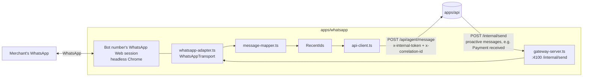

# WhatsApp integration

Katale AI uses [`whatsapp-web.js`](https://wwebjs.dev/guide/) for development and the hackathon
demo. It is isolated so it can be replaced by the official **WhatsApp Cloud API** later
([ADR 0002](decisions/0002-whatsapp-behind-adapter.md)).

**Status (2026-10-05): verified end to end with a real WhatsApp account, text only.** See
[Verified behaviour](#verified-behaviour-2026-10-05).

## Process layout



| File                  | Role                                                                                      |
| --------------------- | ----------------------------------------------------------------------------------------- |
| `whatsapp-adapter.ts` | **Only** file importing `whatsapp-web.js`: `LocalAuth`, QR, events, send.                 |
| `message-mapper.ts`   | Pure mapping to `InboundChannelMessage`: message-ID derivation, skips, unsupported types. |
| `dedupe.ts`           | Bounded recently-seen set (the same message can arrive via two events).                   |
| `api-client.ts`       | Forwards to the API with `x-internal-token` and a per-message correlation ID.             |
| `gateway-server.ts`   | Internal HTTP endpoint for proactive messages (payment received, payment links).          |

The worker contains no business logic: no LLM, database or PayPal calls. Every reply, including
"not registered" and "coming soon", is decided by the API.

## Setup

### 1. Use a dedicated bot number

Link a **dedicated WhatsApp number** for Katale AI (a spare SIM or a WhatsApp Business test
number), never a personal main account. The merchant messages that number from their own WhatsApp.

### 2. Chrome / Puppeteer

Puppeteer downloads its own Chrome on `pnpm install`. If launch fails (e.g. `Failed to launch the
browser process … dlopen … Framework`), point the worker at an installed browser:

```bash
WHATSAPP_CHROME_PATH=/Applications/Google Chrome.app/Contents/MacOS/Google Chrome
```

`WHATSAPP_HEADLESS=true` (default) runs it invisibly. The Docker image uses the distro Chromium.

### 3. QR authentication (`LocalAuth`)

```bash
pnpm dev:whatsapp
```

1. A QR code is printed in the terminal. It refreshes every ~20 s.
2. On the **bot phone**: WhatsApp → Settings → **Linked devices → Link a device** → scan.
3. The log shows `WhatsApp authenticated (session saved)` then `WhatsApp client ready`.
4. The session is stored in `WHATSAPP_SESSION_DIR/session-<WHATSAPP_CLIENT_ID>`
   (default `.data/whatsapp-session/session-katale-dev`), which is **git-ignored** (`.data/`, `.wwebjs_*`).
   Restarts reuse it, with no QR (verified: ready about 4 s after restart).

### 4. Register the merchant's WhatsApp ID

Only registered operator IDs can use Katale AI; each ID maps to **exactly one** merchant (unique constraint).

1. Send the bot any message from the merchant's WhatsApp.
2. Katale AI replies that the number isn't linked and shows **"Your WhatsApp ID: …"**. The API also logs
   `message from unknown sender ignored` with the `senderId`.
3. Register it:

   ```bash
   pnpm operator:add <whatsappId> "Owner name"
   ```

   Or set `SEED_MERCHANT_WHATSAPP_ID` and run `pnpm db:seed`.

**ID formats.** WhatsApp identifies senders either by phone number or by a privacy-preserving linked ID:

| Format                       | Example               | Notes                                                                                         |
| ---------------------------- | --------------------- | --------------------------------------------------------------------------------------------- |
| `<countrycode><number>@c.us` | `256700000000@c.us`   | No `+`, spaces or leading zeros                                                               |
| `<digits>@lid`               | `201234567890123@lid` | **What we observed** for a real merchant account in 2026; not derivable from the phone number |

Use exactly what the onboarding reply or log shows. Unknown senders never create merchants,
conversations, messages or orders. They get the onboarding reply at most once per hour (in-memory throttle).

### 5. Recovery

| Situation                                                            | What to do                                                                                                                             |
| -------------------------------------------------------------------- | -------------------------------------------------------------------------------------------------------------------------------------- |
| `auth_failure`, or the QR keeps appearing after a restart            | Stop the worker, delete `.data/whatsapp-session/session-<clientId>`, start again and re-scan                                           |
| Bot phone unlinked the device / logged out (`WhatsApp disconnected`) | Restart the worker and re-scan                                                                                                         |
| WhatsApp Web update breaks the library                               | Pin/upgrade `whatsapp-web.js`; the Agent Console runs the same pipeline as a fallback                                                  |
| Payment notification not delivered                                   | The API logs `notification delivery failed` and audits `notification.failed`; the message is still stored and visible in the dashboard |

## Message handling

| WhatsApp input                                                                            | Behaviour                                                                                                                                                                                                    |
| ----------------------------------------------------------------------------------------- | ------------------------------------------------------------------------------------------------------------------------------------------------------------------------------------------------------------ |
| Text (`chat`) from an operator                                                            | Inbound pipeline: confirmation reply or agent (real LLM + tools)                                                                                                                                             |
| Voice note (`ptt`/`audio`), `VOICE_NOTES_ENABLED=true`                                    | Pre-check WhatsApp's duration (≤ `VOICE_MAX_DURATION_SECONDS`), `downloadMedia`, forward base64 as `type=audio`; "🎙️ Voice note received…" if the API takes > 2.5 s. See [voice commerce](voice-commerce.md) |
| Voice note, `VOICE_NOTES_ENABLED=false` (default)                                         | **Not downloaded**; reply "Voice messages are coming soon…"                                                                                                                                                  |
| Voice download fails / too long                                                           | "I couldn't access that voice note…" / "…too long for now. Please keep it under 60 seconds…"                                                                                                                 |
| Image, video, document, sticker, location, contact, poll                                  | Forwarded as `unsupported` (no media); polite "I can't read … yet" reply                                                                                                                                     |
| Groups, status broadcasts, WhatsApp Channels (`@newsletter`), own messages, system events | Skipped silently (logged at debug)                                                                                                                                                                           |
| Any message from an unknown sender                                                        | Onboarding reply with the sender's ID (throttled); nothing stored                                                                                                                                            |

### Message IDs and de-duplication

- The external ID is WhatsApp's `<fromMe>_<remote>_<id>`. `whatsapp-web.js` types promise
  `id._serialized`, but current WhatsApp Web builds can omit it, so `serializeMessageId()` rebuilds it
  from `fromMe/remote/id`. Since October 2026 some builds expose the serialized ID as `id.$1`, which is
  tried second. Messages without a usable ID are skipped (never forwarded with `undefined`).

### Patched `whatsapp-web.js` (voice download)

`whatsapp-web.js` 1.34.7's `downloadMedia()` fails on current WhatsApp Web (error `r: r`): it looks the
message up by `id._serialized` (now `id.$1`) and calls `downloadAndMaybeDecrypt` without the now-required
`mimetype`. [`patches/whatsapp-web.js@1.34.7.patch`](../../patches/whatsapp-web.js@1.34.7.patch) (applied by
pnpm via `pnpm.patchedDependencies`, also inside the Docker build) fixes both. When upgrading
`whatsapp-web.js`, check whether upstream has fixed it and drop or regenerate the patch.

- Layer 1 — worker: `RecentIds` drops repeats (needed because we listen to two events, see below).
- Layer 2 — API: `Message @@unique([channel, externalMessageId])` returns `status: duplicate` with no side effects.
  Verified by replaying real WhatsApp messages: re-sending the order message created no second order,
  and re-sending `CONFIRM` created no second PayPal order.

### Events

`whatsapp-web.js`'s `message` event was **not emitted** for some messages from an `@lid` contact.
The adapter listens to `message` **and** `message_create` (incoming only); de-duplication makes
double delivery harmless.

## Outbound messages

- Replies to inbound messages are returned in the API response and sent by the worker.
- Proactive messages (✅ _Payment received_, payment links to customers with a known WhatsApp ID)
  go API → `HttpWhatsAppSender` → worker `POST /internal/send` (token-authenticated) → WhatsApp.
- "Payment received" is built only from trusted payment state and sent exactly once:
  `markCompleted` is a conditional update, so repeated PayPal callbacks don't re-notify (verified live).

## Traceability

The worker creates one correlation ID per WhatsApp message and sends it as `x-correlation-id`. The API
uses it as the transaction trace: order, confirmation, PayPal request, capture and the outbound
gateway call (`outbound message delivered` in the worker log) all carry the same ID. See
`/activity?trace=<id>` in the dashboard. Phone numbers and IDs are not logged by the worker,
except the unknown-sender ID in the API log (needed for onboarding).

## Verified behaviour (2026-10-05)

Real bot number (linked via QR) ↔ real merchant WhatsApp account (`@lid`), real LLM (`gpt-4.1-mini`),
real PayPal Sandbox:

| Check                                                           | Result             |
| --------------------------------------------------------------- | ------------------ |
| QR authentication                                               | PASS               |
| Session persistence across restarts (no QR)                     | PASS               |
| Unknown sender → onboarding reply with ID, nothing stored       | PASS               |
| Merchant mapping (`operator:add`, one ID → one merchant)        | PASS               |
| Text order → branded backend summary ($140.00)                  | PASS               |
| Wrong code / expired code / reused code                         | PASS / PASS / PASS |
| `CONFIRM` → real PayPal order, tappable link in WhatsApp        | PASS               |
| Sandbox payment → capture → ✅ _Payment received_ on WhatsApp   | PASS               |
| Repeated PayPal callbacks → still one notification              | PASS               |
| Redelivered WhatsApp messages (order + confirm) → no duplicates | PASS               |
| "How much have I sold this week?" via `get_sales_summary`       | PASS               |
| Clarification across messages ("some baskets" → "2")            | PASS               |
| $20,000 request → ⚠️ price warning + ⛔ limit refusal           | PASS               |
| Photo / voice note → polite replies, no download (voice off)    | PASS               |
| Voice note (voice on, production) → transcript → draft → paid   | PASS (2026-10-06)  |
| WhatsApp Channel posts → skipped, no reply                      | PASS               |

## Limitations of `whatsapp-web.js` (read before demoing)

- **Unofficial.** It automates WhatsApp Web. WhatsApp may restrict numbers that behave like bots
  (bulk or unsolicited messages). Use a dedicated test number.
- **Fragile.** WhatsApp Web changes break it (we hit three: a missing `id._serialized`, missing
  `message` events and broken `downloadMedia`). Pin versions before a demo.
- **Heavy.** Each session is a Chrome instance (~300–500 MB RAM).
- **One session per number**, tied to the linked device. If the phone unlinks it, re-scan.
- **No delivery webhooks/SLAs**, no template messages, no business verification.
- **Payment links opened on a phone** redirect to `API_PUBLIC_URL`. With `http://localhost:4000` the
  phone can't reach your Mac, so capture waits for a webhook. For phone payments, expose the API
  with a tunnel and set `API_PUBLIC_URL` + `PAYPAL_WEBHOOK_ID` ([real services guide](../development/real-services.md)).
  On a laptop-only demo, open the link on the Mac.
- Bots in busy groups receive lots of traffic; it is skipped, but it still costs CPU.

## Production (Docker)

The `katale-whatsapp` image ships Debian Chromium (`WHATSAPP_CHROME_PATH=/usr/bin/chromium`) and runs as
uid 1000. The session lives on the VM at `/opt/apps/katale-ai/data/whatsapp/session-katale-prod`
(bind mount, owned by 1000, mode 700), never in the image. Stale Chromium `Singleton*` locks are removed
at start, so restarts and recreations reconnect without a QR (verified). QR when needed:
`docker compose logs -f whatsapp`. Run **one** worker per bot number: stop local `pnpm dev:whatsapp` and
unlink unused devices on the bot phone.

## Migrating to the WhatsApp Cloud API

1. Add `POST /api/channels/whatsapp/webhook` in the API (verify `X-Hub-Signature-256`), map Graph
   payloads to `InboundChannelMessage`, and download media via the Graph media endpoint.
2. Implement a `CloudApiWhatsAppSender implements ChannelSender` and register it instead of `HttpWhatsAppSender`.
3. Retire `apps/whatsapp`. Nothing in `commerce`, `ai`, `paypal` or the inbound pipeline changes.
