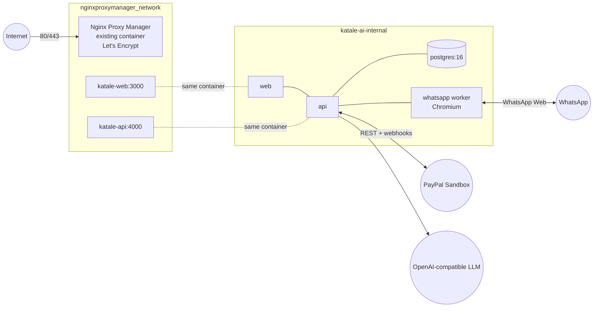

# Deployment: Docker Hub images → Linux VM

Katale AI is deployed as **prebuilt production images**. Nothing is built on the server.

```text
build locally (pnpm verify gate) → push immutable tags to Docker Hub
  → VM: docker compose pull → migrate → up -d
  → Nginx Proxy Manager (existing, on the VM) → HTTPS (Let's Encrypt) → https://kataleai.space
```

## Architecture on the VM



- **No host ports are published** by Katale AI. NPM reaches `katale-web` / `katale-api` by DNS alias on
  its own Docker network. Postgres and the WhatsApp gateway exist only on `katale-ai-internal`.
- Publicly routed: `/` → dashboard, `/api/paypal/*` (return, cancel, webhooks) and `/api/health` → API.
  Every other `/api/*` route returns 404 at the proxy. The dashboard talks to the API inside Docker.

> **Why Nginx Proxy Manager, not host nginx:** on this VM, ports 80/443 belong to an existing
> Nginx Proxy Manager container that serves the other sites; `nginx.service` on the host is masked.
> Running host nginx would have meant taking 80/443 away from NPM and breaking those sites, so
> Katale AI is added as an NPM proxy host instead. NPM is nginx and handles Let's Encrypt itself.

## Current production release

| Image                         | Tag                   | Digest (linux/amd64)                                                      |
| ----------------------------- | --------------------- | ------------------------------------------------------------------------- |
| `yigagilbert/katale-api`      | `v0.1.0-202610170605` | `sha256:f8ba79123545a74cfcdb107cc9381e2da1071af6432110ff94606c1c0864d26c` |
| `yigagilbert/katale-web`      | `v0.1.0-202610170605` | `sha256:51c17267c1a47f2e467e055674e83375c09d9558201fefc169dbf4fe6999744e` |
| `yigagilbert/katale-whatsapp` | `v0.1.0-202610170605` | `sha256:e6f60fd0033678e122cc461cc8da33d6da741689d38b801ab325e08c3bcf110e` |

Release history (rollback = set `KATALE_TAG` to an earlier tag and re-run `vm-deploy.sh`; rolling back is safe: the migrations since
`v0.1.0-202610051458` only add columns, tables and enum values):

| Tag                   | Contents                                                                                                                                                                                                    |
| --------------------- | ----------------------------------------------------------------------------------------------------------------------------------------------------------------------------------------------------------- |
| `v0.1.0-202610170605` | Inventory ledger + alerts, catalog/stock tools, WhatsApp charts, period comparisons, dashboard WhatsApp page (QR/reconnect/unlink), call handling; migration `inventory_movements` (additive) (**current**) |
| `v0.1.0-202610071145` | Shipment tracking (Orders v2) and PayPal disputes (Disputes v1), Disputes page, operations analytics; migration `shipments_and_disputes` (additive)                                                         |
| `v0.1.0-202610071011` | AG Grid + AG Studio dashboard, merchant analytics tools, buyer pages, English-only voice default, demo reset; migration `order_input_mode`                                                                  |
| `v0.1.0-202610061859` | Luganda number normaliser, voice customer guard, non-catalog warnings                                                                                                                                       |
| `v0.1.0-202610060937` | Patched `whatsapp-web.js` voice download, `@newsletter` skip                                                                                                                                                |
| `v0.1.0-202610060910` | Dashboard login, voice notes (Whisper + Sunbird cascade)                                                                                                                                                    |
| `v0.1.0-202610051458` | First production release (text, PayPal, webhooks)                                                                                                                                                           |

First deployed 2026-10-06 to `217.65.145.220` → **https://kataleai.space** (NPM proxy host #26, Let's Encrypt
certificate #36, expires 2027-01-04, auto-renewed by NPM). PayPal Sandbox webhook registered for
`https://kataleai.space/api/paypal/webhooks`.

## Images

| Repository                    | Contents                                                                                                 | Runs as           |
| ----------------------------- | -------------------------------------------------------------------------------------------------------- | ----------------- |
| `yigagilbert/katale-api`      | Fastify API (`dist/index.js`), production deps, `katale-migrate`, `dist/seed.js`, `dist/operator-add.js` | `node` (uid 1000) |
| `yigagilbert/katale-web`      | Next.js **standalone** server                                                                            | `node`            |
| `yigagilbert/katale-whatsapp` | WhatsApp worker + Debian **Chromium** (`/usr/bin/chromium`)                                              | `node`            |
| `postgres:16-alpine`          | Official image (not rebuilt)                                                                             | `postgres`        |

All three come from one multi-stage [`docker/Dockerfile`](../../docker/Dockerfile) (targets `api`, `web`,
`whatsapp`) with a shared cached build stage. Images contain no `.env`, sessions, `.git`, tests or
host `node_modules` ([`.dockerignore`](../../.dockerignore)). Secrets are injected at runtime.

### Tag strategy

| Tag                                     | Example               | Use                                           |
| --------------------------------------- | --------------------- | --------------------------------------------- |
| `v<package version>-<UTC yyyymmddHHMM>` | `v0.1.0-202610051458` | **Deploy this** (immutable)                   |
| `<git short sha>`                       | `a1b2c3d`             | Added automatically once the repo has commits |
| `latest`                                |                       | Convenience only; never referenced by the VM  |

The VM's `.env` pins `KATALE_TAG`, so deploy and rollback both mean changing one line.

## Build and push (developer machine)

Prerequisites: Docker with buildx, `docker login` as the Docker Hub user (interactive; never stored in the repo).

```bash
KATALE_IMAGE_NAMESPACE=yigagilbert PLATFORMS=linux/amd64 ./scripts/release-images.sh
```

The script runs `pnpm verify` (lint, format, typecheck, tests, build) and stops on failure. It then
builds the three targets for the VM's architecture, pushes `:<tag>` and `:latest`, and prints each
digest. Set `PLATFORMS=linux/amd64,linux/arm64` for multi-arch (needs ~15 GB free in Docker Desktop).

Optional local rehearsal of the production stack (exactly the VM compose file, locally built images):
see "Local rehearsal" below.

## VM layout

```text
/opt/apps/katale-ai/
├── docker-compose.yml        ← deploy/docker-compose.prod.yml
├── .env                      ← chmod 600, from deploy/.env.production.example
├── data/
│   ├── postgres/             ← Postgres data (bind mount)
│   └── whatsapp/             ← WhatsApp LocalAuth session (owned by uid 1000, mode 700)
├── backups/                  ← pg_dump .sql.gz (mode 700)
└── deployment/               ← vm-deploy.sh, backup.sh, restore.sh, npm-advanced.conf, env template
```

The VM needs only Docker + Compose (and NPM, already present). No Node.js or pnpm.

### First-time setup

```bash
ssh deploy@<vm>
mkdir -p /opt/apps/katale-ai/{data/postgres,data/whatsapp,backups,deployment}
cd /opt/apps/katale-ai
```

Copy `deploy/docker-compose.prod.yml` to `docker-compose.yml`, and the files in `deploy/` into
`deployment/`. Then create `.env` from `deployment/.env.production.example` (generate secrets with
`openssl rand -hex 32`) and run `chmod 600 .env`.

The WhatsApp container runs as uid 1000 and needs to own its session directory (no sudo required):

```bash
docker run --rm -v "$PWD/data/whatsapp:/d" alpine:3.20 sh -c 'chown 1000:1000 /d && chmod 700 /d'
```

```bash
./deployment/vm-deploy.sh
```

```bash
docker compose run --rm api node dist/seed.js
```

The seed is idempotent upserts, never a reset.

## Environment

See [`deploy/.env.production.example`](../../deploy/.env.production.example). Key production values:

| Variable                                              | Value                                                                                                                                  |
| ----------------------------------------------------- | -------------------------------------------------------------------------------------------------------------------------------------- |
| `KATALE_IMAGE_NAMESPACE` / `KATALE_TAG`               | `yigagilbert` / immutable tag                                                                                                          |
| `API_PUBLIC_URL`, `CORS_ORIGINS`                      | `https://kataleai.space`; PayPal return/cancel URLs derive from it                                                                     |
| `DATABASE_URL`                                        | `postgresql://katale:<pw>@postgres:5432/katale` (internal host `postgres`)                                                             |
| `PAYPAL_ENV` / `PAYPAL_WEBHOOK_ID`                    | `sandbox` / ID from `pnpm paypal:webhook register …` (events: `pnpm paypal:webhook sync …`)                                            |
| `PAYPAL_CAPTURE_ON_RETURN`                            | `true`; set `false` to force webhook-only capture (testing)                                                                            |
| `VOICE_NOTES_ENABLED`                                 | `true` (since v0.1.0-202610060910); worker and API share it                                                                            |
| `STT_API_KEY` / `STT_MODEL`                           | OpenAI key / `whisper-1` (English)                                                                                                     |
| `SUNBIRD_API_KEY`                                     | Sunbird AI token: enables the Luganda speech-to-text cascade                                                                           |
| `VOICE_MAX_DURATION_SECONDS` / `VOICE_MIN_CONFIDENCE` | `60` / `0.5`                                                                                                                           |
| `TRANSLATION_PROVIDER` / `VOICE_TRANSLATE_LANGUAGES`  | `sunbird` / `""` (LLM reads Luganda directly; `lg` = translate first)                                                                  |
| `DASHBOARD_USERNAME` / `DASHBOARD_PASSWORD`           | Dashboard login. No password = every login refused. Use a long random password                                                         |
| `WHATSAPP_CLIENT_ID`                                  | `katale-prod`; changing it starts a new session (QR)                                                                                   |
| `WHATSAPP_PRINT_QR` / `WHATSAPP_REJECT_CALLS`         | `false` recommended (pair from the dashboard) / `true` (decline calls, suggest voice notes)                                            |
| `DEFAULT_PHONE_REGION`                                | `UG`: country for local admin numbers (`0772…` → `+256772…`)                                                                           |
| `REPORT_SCHEDULER_ENABLED`                            | `true` (default) on the single API container; `false` on any extra replica. Also runs the PayPal sweep and the WhatsApp outage monitor |
| `UNAUTHORIZED_REPLY_COOLDOWN_HOURS`                   | `24`: one generic welcome per unregistered number per period                                                                           |
| `PAYMENT_RECONCILIATION_ENABLED`                      | `true`: re-check open PayPal links every 6 h in the background                                                                         |
| `CUSTOMER_COMMERCE_ENABLED`                           | `false` until customer shopping is approved; then also enable it per number in the dashboard                                           |
| `CUSTOMER_COMMERCE_PILOT_NUMBERS`                     | E.164 test numbers that may shop while the switch is off (controlled testing). Never admin numbers of the shop                         |

Compose sets the in-container values (`TRUST_PROXY=true`, internal URLs, session path).

## Database migrations

`vm-deploy.sh` runs, in order: `pull` → start Postgres → **backup** → `docker compose run --rm api katale-migrate`
(`prisma migrate deploy`: applies committed migrations, never resets) → `up -d`. A failed migration
stops the script before new containers start. Never run `prisma migrate reset`/`dev` in production.

## Persistent storage

| Data             | Location                                     | Survives                                            |
| ---------------- | -------------------------------------------- | --------------------------------------------------- |
| Postgres         | `data/postgres` (bind mount)                 | image upgrades, `down`/`up`, Docker restart, reboot |
| WhatsApp session | `data/whatsapp/session-<WHATSAPP_CLIENT_ID>` | same; stale Chromium locks are cleared on start     |

`restart: unless-stopped` brings everything back after a Docker or VM restart.

## Reverse proxy and HTTPS (Nginx Proxy Manager)

1. DNS: **A record `kataleai.space` → `217.65.145.220`** (and optionally `www`). Check with `dig +short kataleai.space`.
2. NPM (`http://<vm>:81`) → **Hosts → Proxy Hosts → Add Proxy Host**:
   - **Details:** Domain `kataleai.space`; Scheme `http`; Forward Hostname `katale-web`; Port `3000`;
     enable _Block Common Exploits_ and _Websockets Support_.
   - **SSL:** _Request a new SSL Certificate_ (Let's Encrypt); enable _Force SSL_, _HTTP/2_, _HSTS_; agree to the LE terms.
   - **Advanced:** paste [`deploy/npm-advanced.conf`](../../deploy/npm-advanced.conf) (routes `/api/paypal/*` and
     `/api/health` to `katale-api:4000`, blocks other `/api/*`).
   - The dashboard is protected by the app's own **login page** (`/login`, signed HttpOnly session
     cookie, 12 h; configured via `DASHBOARD_USERNAME` / `DASHBOARD_PASSWORD`). Every dashboard page and
     server action requires it; `/api/paypal/*` and `/api/health` are API routes and stay public.
     An NPM Access List is not needed (if added, the snippet keeps PayPal routes public with `auth_basic off`).

   The production host was created through NPM's own API from the logged-in admin session (same
   payload as the form). NPM ignored the SSL flags on create, so Force SSL / HTTP2 / HSTS were applied
   with a follow-up update. Check that _SSL → Force SSL_ is on after creating a host.

3. Certificate renewal is automatic in NPM. Check the certificate under _SSL Certificates_.

Start the Katale containers before saving the proxy host. NPM's nginx resolves `katale-web` /
`katale-api` when it loads the config.

## PayPal webhook

From the developer machine (uses the Sandbox REST app credentials in `.env`):

```bash
pnpm paypal:webhook register https://kataleai.space/api/paypal/webhooks
```

This subscribes `CHECKOUT.ORDER.APPROVED`, `PAYMENT.CAPTURE.COMPLETED`, `PAYMENT.CAPTURE.DECLINED`,
`PAYMENT.CAPTURE.REFUNDED` and `PAYMENT.CAPTURE.REVERSED`, and prints `PAYPAL_WEBHOOK_ID=…`. Put that in the
VM `.env`, then `docker compose up -d api`. List with `pnpm paypal:webhook list`. Forged or unsigned calls get 401.

## WhatsApp session

```bash
docker compose logs -f whatsapp
```

On first start (or after a new `WHATSAPP_CLIENT_ID`) the dashboard's **WhatsApp** page shows the QR
(and, unless `WHATSAPP_PRINT_QR=false`, it is also printed in the logs). Scan it from the bot
phone: _Linked devices → Link a device_. The log then shows `authenticated (session saved)` and `client ready`.

Register the merchant: send the bot a message, then run the command below with the ID from the reply:

```bash
docker compose run --rm api node dist/operator-add.js <id>@lid "Owner"
```

Recovery: stop the worker, remove `data/whatsapp/session-katale-prod`, start, re-scan.
**Only one worker per number may run.** Stop any local `pnpm dev:whatsapp` on the same bot number.

## Operations

| Task                  | Command (in `/opt/apps/katale-ai`)                                                    |
| --------------------- | ------------------------------------------------------------------------------------- |
| Status                | `docker compose ps`                                                                   |
| Logs                  | `docker compose logs -f --tail=200 api` (or `web`, `whatsapp`, `postgres`)            |
| Restart one service   | `docker compose restart api`                                                          |
| Apply `.env` changes  | `docker compose up -d` (recreates changed services)                                   |
| Deploy / update       | `./deployment/vm-deploy.sh <new-tag>`                                                 |
| Rollback              | `./deployment/vm-deploy.sh <previous-tag>`                                            |
| Backup now            | `./deployment/backup.sh`                                                              |
| Restore               | `./deployment/restore.sh backups/<file>.sql.gz` (asks for confirmation)               |
| Seed demo data        | `docker compose run --rm api node dist/seed.js`                                       |
| Add WhatsApp operator | `docker compose run --rm api node dist/operator-add.js <id> "Name"`                   |
| Free old images       | `docker image prune -a --filter "until=168h"` (unused images only; never `--volumes`) |

**Rollback caveat:** migrations are forward-only. Rolling back to an image older than a migration
works if the migration was additive (all current ones are). Otherwise restore the pre-deploy backup
that `vm-deploy.sh` wrote.

**Backups:** `backup.sh` keeps the newest 14 dumps (`KEEP=n`). Recommended: a daily cron
(`0 2 * * * cd /opt/apps/katale-ai && ./deployment/backup.sh daily`) and copying dumps off the VM
periodically. Restore is tested by `restore.sh`, which takes a safety backup first.

## Local rehearsal

```bash
docker buildx build -f docker/Dockerfile --target api -t katale-local/katale-api:test --load .
```

Build `web` and `whatsapp` the same way. Then, in a scratch directory: copy
`deploy/docker-compose.prod.yml`, create a `.env` with `KATALE_IMAGE_NAMESPACE=katale-local`,
`KATALE_TAG=test` and `KATALE_PROXY_NETWORK=<a test network>`, and run
`docker compose run --rm api katale-migrate` followed by `docker compose up -d --pull never`. Put
any nginx container on the test network with `npm-advanced.conf` to mimic NPM.

## Known infrastructure gaps (deferred)

Recorded deliberately and **not** addressed yet:

- The VM `deploy` user still accepts password SSH; rotate the password, move to key-only SSH.
- Nginx Proxy Manager's admin UI (port **81**) is reachable from the internet; restrict it (firewall or VPN).
- No broader firewall review, VPN/bastion, or redundancy (one VM, one Postgres, one WhatsApp session).
- Backups are taken by `vm-deploy.sh` on each deploy, not on a schedule.

## Troubleshooting

| Symptom                                                                     | Fix                                                                                                                                                                                                                                                                                           |
| --------------------------------------------------------------------------- | --------------------------------------------------------------------------------------------------------------------------------------------------------------------------------------------------------------------------------------------------------------------------------------------- |
| `pull access denied`                                                        | Wrong `KATALE_IMAGE_NAMESPACE`/`KATALE_TAG`, or the repo is private and the VM isn't logged in                                                                                                                                                                                                |
| API unhealthy at start                                                      | `docker compose logs api`; often `DATABASE_URL`/`POSTGRES_PASSWORD` mismatch                                                                                                                                                                                                                  |
| NPM shows 502                                                               | Katale containers not running, or not on `nginxproxymanager_network` (`docker network inspect …`)                                                                                                                                                                                             |
| Dashboard actions fail: "Invalid Server Actions request"                    | The proxy must pass the original `Host`; Origin and Host must match (NPM default does)                                                                                                                                                                                                        |
| WhatsApp: "profile appears to be in use"                                    | Handled automatically (stale locks removed); if it persists, stop the worker and delete `data/whatsapp/session-*/Singleton*`                                                                                                                                                                  |
| WhatsApp: QR again after redeploy                                           | `WHATSAPP_CLIENT_ID` changed or `data/whatsapp` not mounted/owned by uid 1000                                                                                                                                                                                                                 |
| Payment stays `APPROVED`                                                    | Check webhook delivery in the PayPal dashboard and `docker compose logs api                                                                                                                                                                                                                   | grep webhook` |
| Disk full during build (local)                                              | Prune build cache: `docker builder prune` (multi-arch builds need ~15 GB free)                                                                                                                                                                                                                |
| Voice note → "I couldn't access that voice note…"                           | `whatsapp-web.js` patch not applied: check `patches/` is in the image (`pnpm.patchedDependencies`)                                                                                                                                                                                            |
| `/api/paypal/*` or `/api/health` → 502 right after a deploy, dashboard fine | NPM still points at the old `katale-api` IP. `vm-deploy.sh` now reloads NPM (`docker exec nginx-proxy-manager-app-1 nginx -s reload`); the durable fix is the variable `proxy_pass` in [`deploy/npm-advanced.conf`](../../deploy/npm-advanced.conf) pasted into the proxy host's Advanced tab |
| `push access denied … insufficient_scope`                                   | Docker Desktop is logged in as another account: `docker login -u yigagilbert` (use an access token)                                                                                                                                                                                           |
| Domain still shows the registrar parking page                               | The record must be type **A** (not TXT/CNAME): `dig +short @dns1.registrar-servers.com kataleai.space A`                                                                                                                                                                                      |
| First PayPal webhooks after registering never arrive                        | Seen in Sandbox for events ~3 min after registration; later deliveries were automatic. Redeliver with PayPal's resend API or the dashboard; the return URL still captures                                                                                                                     |
| Brief 502/"could not be resolved" right after `docker compose down`         | Expected while containers restart; NPM re-resolves `katale-web`/`katale-api` automatically                                                                                                                                                                                                    |
