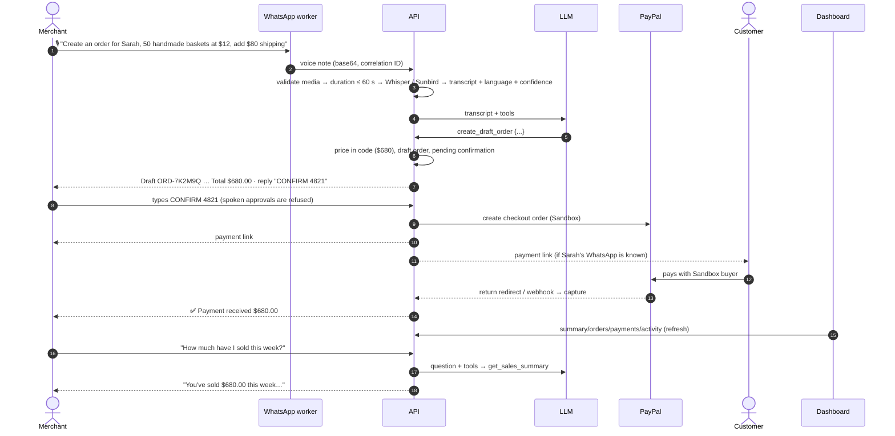

# Demo flow

> **Final 5-minute script: [final-demo-script.md](final-demo-script.md).**
> Live at **https://kataleai.space** (production images on the VM; dashboard login required). Step-by-step
> scripts: [voice-demo.md](voice-demo.md) (English voice) and
> [whatsapp-text-demo.md](whatsapp-text-demo.md). In production, step 11 is completed by the real PayPal
> webhook even if the buyer never returns.

One excellent journey, end to end. Every step below maps to code that exists today; the
**Status** column is honest about what has been verified.

| #     | Step                              | Implemented in                                                  | Status                                                                   |
| ----- | --------------------------------- | --------------------------------------------------------------- | ------------------------------------------------------------------------ |
| 1     | Merchant sends voice note         | `apps/whatsapp` adapter + mapper                                | ✔ real WhatsApp text and voice notes (production)                        |
| 2     | Download + transcribe             | `downloadMedia` → `decodeAudioMedia` → `SpeechPipeline`         | ✔ English (Whisper); other languages read back (Luganda frozen)          |
| 3     | Intent identified                 | `runAgent` + tool registry                                      | ✔ real LLM (gpt-4.1-mini) via Agent Console                              |
| 4     | Entities extracted                | `draftOrderCommandSchema`                                       | ✔                                                                        |
| 5     | Backend validates & calculates    | `OrderService.price` / `calculateOrderTotals`                   | ✔ integration-tested                                                     |
| 6     | Structured draft on WhatsApp      | `formatOrderSummary` + `formatConfirmationPrompt`               | ✔ real WhatsApp (branded backend summary)                                |
| 7     | Merchant confirms                 | `parseConfirmationReply` → `ConfirmationService.claim`          | ✔ real WhatsApp (CONFIRM + code)                                         |
| 8     | PayPal Sandbox payment request    | `ConfirmationExecutor` → `PaymentService.createCheckout`        | ✔ real PayPal Sandbox order                                              |
| 9     | Customer receives link            | `NotificationService.toCustomer`                                | ✔ tappable link in WhatsApp; customer push needs customer WhatsApp ID    |
| 10    | Sandbox payment succeeds          | PayPal hosted checkout                                          | ✔ Sandbox buyer paid $140.00                                             |
| 11    | Webhook / return updates order    | `PayPalWebhookService`, `/api/paypal/return`, `captureApproved` | ✔ return URL capture and real PayPal webhooks (production)               |
| 12    | "Payment received" on WhatsApp    | `PaymentService.markCompleted` → notification                   | ✔ real WhatsApp, sent once                                               |
| 13    | Dashboard updates                 | `apps/web` (server-rendered on each load)                       | ✔ AG Grid (orders, payments, customers, products) + AG Studio analytics  |
| 14–15 | "How much have I sold this week?" | `get_sales_summary` → `AnalyticsService`                        | ✔ real LLM answered from DB (plus voice vs text, top products/customers) |

The whole sequence (with fakes for PayPal and the LLM) runs in `tests/integration/demo-flow.test.ts`.

## Rehearsal checklist

1. `.env`: `AI_API_KEY`, `STT_API_KEY` (+ `SUNBIRD_API_KEY` for Luganda), `VOICE_NOTES_ENABLED=true`, PayPal Sandbox credentials, `SEED_MERCHANT_WHATSAPP_ID` = the merchant phone's WhatsApp ID.
2. `pnpm db:seed` (re-run after changing the operator ID).
3. Optional: give _Sarah Thompson_ a `whatsappId` (Prisma Studio) so she receives the link directly — use a second test phone.
4. `pnpm dev` and `pnpm dev:whatsapp`; scan the QR with the **bot** phone.
5. Dry-run the text version in the dashboard **Agent console** first.
6. Open the Sandbox buyer account in a browser tab, logged in, before going on stage.
7. Keep the dashboard **Activity** page open — it shows the AI decisions and confirmations live (refresh).

## Script (≈ 3 minutes)

1. _Problem_ (20 s): "Small merchants sell in chats, not storefronts. Payment and bookkeeping are manual."
2. _Voice note_ (40 s): speak the order. Show the deterministic summary arriving on WhatsApp; approve by **typing** the code.
3. _Trust_ (20 s): point out the confirmation code and that totals come from code, not the AI.
4. _Pay_ (40 s): confirm → open the link → pay with Sandbox buyer → "Payment received" arrives.
5. _Dashboard_ (30 s): revenue, order status, activity log with correlation IDs.
6. _Ask_ (20 s): "How much have I sold this week?" — answered from the database.
7. _Close_ (10 s): AG Grid / AG Studio analytics, then the roadmap (local languages, other channels).

## Fallbacks

- No WhatsApp on stage → run the identical flow in the dashboard **Agent console** (same pipeline, channel `web`).
- No internet for webhooks → the PayPal return redirect captures the payment locally.
- ASR misfires → send the same request as text; the rest of the flow is identical.
