# Overview redesign: one AG Studio business command center

**Status:** PR 21. Not merged or deployed. See [Deploying](#8-deploying) for the steps.

The Overview answers three questions the moment a merchant signs in: _How is my business
performing? What needs my attention? What should I do next?_

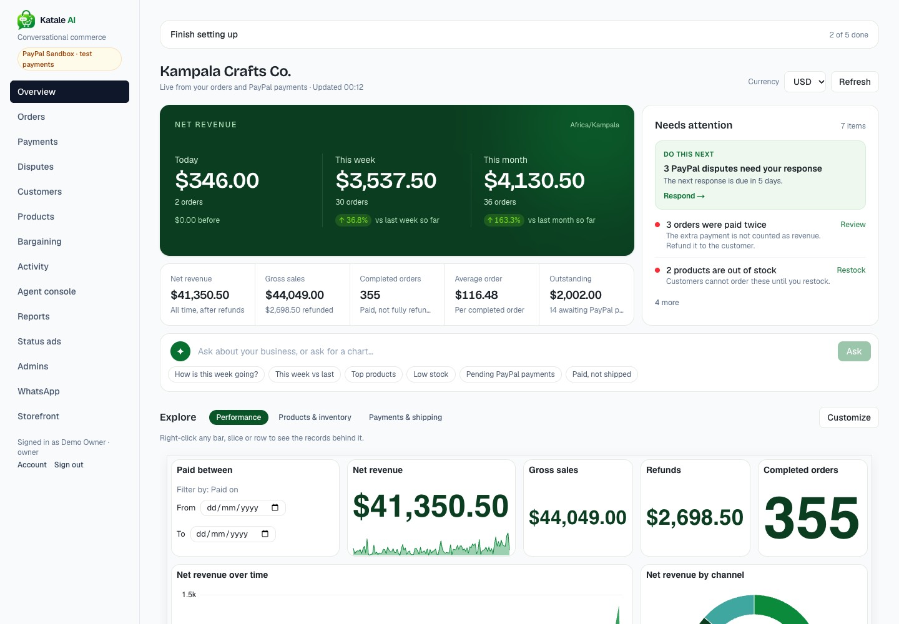

## 1. What we found

| Area          | Before                                            | Problem                                                                                                     |
| ------------- | ------------------------------------------------- | ----------------------------------------------------------------------------------------------------------- |
| Overview      | 10 hand-built stat cards, bar lists, recent lists | No AG Studio, no period comparison, no filters or exploration. Alerts were only counts, with no next step   |
| Analytics     | AG Studio in edit mode, 5 widgets on 1 page       | A separate destination most merchants would never find. Opened on a builder, not a dashboard                |
| AG Studio use | Data sources and the built-in AI                  | Unused: view mode, theming, multiple pages, filter widgets, saved dashboards, data refresh, custom AI tools |
| Loading       | 10,000-row dataset inside the page payload        | The first paint waited for all of it                                                                        |

### Financial defects fixed (P0)

| Defect                                                | Effect                                                                         | Fix                                                                                                                     |
| ----------------------------------------------------- | ------------------------------------------------------------------------------ | ----------------------------------------------------------------------------------------------------------------------- |
| Studio revenue summed `orders.total`                  | Partial refunds overstated revenue                                             | New `net`, `gross` and `refunded` fields; sale fields are zero on non-sales, so a sum is right with or without a filter |
| Every order's currency formatted as the first order's | UGX shown as USD, and USD and UGX summed together                              | Studio holds one currency at a time, with a switcher, so no chart or query can mix them                                 |
| Duplicate payments counted as sales                   | An order paid twice counted twice in revenue, order counts and product revenue | Excluded everywhere and raised as an alert to refund                                                                    |
| Date fields parsed in the viewer's timezone           | Days shifted for viewers elsewhere                                             | `paidOn` and `createdOn` are calendar dates in the merchant's timezone                                                  |
| Daily revenue used the first row's currency           | The report chart's currency could be arbitrary                                 | Uses the currency with the most revenue                                                                                 |
| Customer summary ignored refunds                      | "How much has Sarah spent?" overstated                                         | Subtracts refunds                                                                                                       |
| Row limits were silent                                | Totals could be incomplete with no warning                                     | `meta.truncated` drives a visible notice; headline figures are SQL aggregates and always complete                       |

**Accounting rules.** Net revenue is captured PayPal payments minus completed refunds. A refund
reduces the period of the original sale, not the period it was issued in. Product revenue is line
totals of paid orders excluding shipping; partial refunds aren't split across lines because the
records don't say which line was refunded.

## 2. Architecture: unified Overview (Option B)

| Criterion       | A: Overview + Analytics                                         | B: Unified Overview                                                         |
| --------------- | --------------------------------------------------------------- | --------------------------------------------------------------------------- |
| Usability       | Two places to look, and the good tools hidden behind a nav item | **Everything where the merchant lands**                                     |
| Simplicity      | Two pages explaining similar numbers                            | **One page, with View and Customize**                                       |
| Performance     | Each page loads its own data                                    | **Figures paint first; Studio loads after**                                 |
| Maintainability | Two dashboards to keep consistent                               | **One report, one set of rules**                                            |
| AG Studio fit   | Edit mode on one page, nothing on the other                     | **View mode daily, edit mode on demand: how Studio is designed to be used** |

`/analytics` redirects to `/overview` and is gone from the navigation.

## 3. What is AG Studio and what isn't

| Part                                                       | Built with                               | Why                                                                                                |
| ---------------------------------------------------------- | ---------------------------------------- | -------------------------------------------------------------------------------------------------- |
| Charts, KPIs, tables, date filter, 3 report pages          | **AG Studio view mode**                  | Native                                                                                             |
| Customize: drag and drop, Compose, Data, Filters, AI panel | **AG Studio edit mode**                  | Native                                                                                             |
| Assistant loop, tools, chat panel in Customize             | **AG Studio harness and `defineAiTool`** | Native                                                                                             |
| Today, week and month with % change                        | React, from the API                      | Studio value widgets can't compare periods, and the boundaries must follow the merchant's timezone |
| Needs attention                                            | React, from the API                      | A worklist of links, not a chart                                                                   |
| Ask panel in View mode                                     | React over Studio's session              | Studio only offers its AI panel in edit mode, which doesn't fit a phone                            |
| Page tabs                                                  | React over `api.setState`                | Studio 3.0 shows no page tabs in view mode                                                         |
| Phone layout                                               | `stackedLayout` over report state        | Responsive breakpoints arrive in Studio 3.1                                                        |

**AG Studio 3.1.0** replaced two things here: a hand-written phone layout that rewrote report state,
and the absence of drill-through. AG Grid moved to 36.3 with it, so one grid version ships. Page tabs
and the Ask panel stay custom because 3.1 still has neither in view mode.

## 4. The assistant

Ask from the bar on the page or the chips beneath it. It works on phones too.

Testing changed the design. AG's five-agent setup with this model (`gpt-4.1-mini`) produced
confident wrong answers: "no PayPal payments are pending" when 14 were, after guessing a filter
value and summarizing a summary; a wrong product ranking; and an invented widget type that took the
canvas down. Stricter wording doesn't reliably fix that, so the design removes the opportunity:

- **Deterministic lookups** (`lookups.ts`): pending payments, orders to ship, stock alerts, top
  products and customers, channels, sales in a date range. Computed by code and unit-tested.
- **Backend snapshot** (`get_business_snapshot`): the same figures the page shows.
- **A checked widget catalog** (`widget-catalog.ts`): the assistant picks a known metric and grouping,
  so it can only chart correct fields and valid widgets. AI widgets go on their own "AI dashboard"
  tab, and nothing is kept until the merchant saves.
- **No new powers:** the tools read what the server already computed for this merchant, and none can
  reach the API. It can't refund, ship or message, and says so when asked.
- **Rollback:** a report Studio rejects restores the last good state instead of blanking the page.

Trade-off: the assistant can't build arbitrary widgets. Merchants can, by hand, in Customize.

## 5. Test results

Unit and integration tests run with `pnpm verify` and `pnpm test:integration`.
`tests/integration/overview.test.ts` works its expected figures out by hand. Integration tests need
a database with no dashboard accounts, as before.

Browser checks ran on a production build in headless Chromium against a generated shop (480 orders
over 120 days, two currencies, refunds, duplicates, disputes), with the real LLM.

| Check                                                                                               | Result                |
| --------------------------------------------------------------------------------------------------- | --------------------- |
| Net $41,350.50, gross $44,049.00, refunds $2,698.50, 355 orders, $2,002.00 outstanding, against SQL | PASS                  |
| Studio KPIs equal the headline figures                                                              | PASS                  |
| This week against SQL using Kampala week boundaries                                                 | PASS                  |
| UGX 13,949,390 against SQL, with no `$` anywhere when UGX is selected                               | PASS                  |
| Date filter August: net $7,992.80 and the product ranking, against SQL                              | PASS                  |
| Assistant: this week, week vs last, top products, low stock, pending (14, $2,002.00), to ship       | PASS, matches records |
| Assistant: chart by product, then a full dashboard, on the AI tab                                   | PASS                  |
| Assistant refuses a refund and shipping request, and refuses to forecast                            | PASS                  |
| Save, reload, reset                                                                                 | PASS                  |
| New sale + Refresh: figures and charts update ($41,473.95) and customizations stay                  | PASS                  |
| Each alert link opens the records it counts                                                         | PASS                  |
| Another merchant's data never appears; layouts are per person                                       | PASS                  |
| Signed out: dataset redirects to login, `/studio-ai` returns 401                                    | PASS                  |
| Dataset failure with retry, AI failure, loading skeleton, empty shop                                | PASS                  |
| 1440, 820 and 390 px: no horizontal page scroll                                                     | PASS                  |
| All other dashboard pages load with no page errors                                                  | PASS                  |

| Performance (local production build)          | 480 orders  | 3,000 orders    |
| --------------------------------------------- | ----------- | --------------- |
| First paint with headline figures in the HTML | 48 ms       | 48–72 ms        |
| Canvas drawn                                  | about 1.0 s | about 1.6 s     |
| Dataset size, raw                             | 699 KB      | 4.4 MB          |
| Dataset size, gzip on the wire                | 75 KB       | not re-measured |

Not covered: a real PayPal Sandbox purchase through this page (figures come from generated records),
real phones, and production. The assistant is non-deterministic, so answers vary in wording.

## 6. Demo for the AG Studio prize (about 2 minutes)

Load the data on a local database: `pnpm overview:demo` (it refuses any other, because its accounts
share a password kept in the script). Sign in as `overview-demo`.

1. **Land (15 s).** "A shop owner signs in. Net revenue today, this week and this month with changes.
   On the right, what needs attention, and the single thing to do next."
2. **Act (15 s).** Click _Respond_: it opens exactly those disputes. Go back.
3. **Explore (20 s).** Set _Paid between_ to August and show every chart follow. Right-click a product
   bar to see the records behind it, then go back. Open _Products & inventory_.
4. **Ask (25 s).** Click _Pending PayPal payments_: 14 for $2,002.00, the same as the tile. "It reads
   the real records through AG Studio's agent tools, and it can't move money." Ask it to refund an
   order and let it decline.
5. **Build (30 s).** Type "Build me a dashboard showing revenue, payments, and inventory performance."
   Watch the AI dashboard tab appear. Click _Save dashboard_, then reload: it's still there.
6. **Customize (15 s).** _Customize_ opens AG Studio's full builder. Drag a field on, and open _Data_.
7. **Close (10 s).** Switch to UGX: "Currencies never mix." Show it on a phone.

## 7. Screenshots

|                                             |                                              |
| ------------------------------------------- | -------------------------------------------- |
| 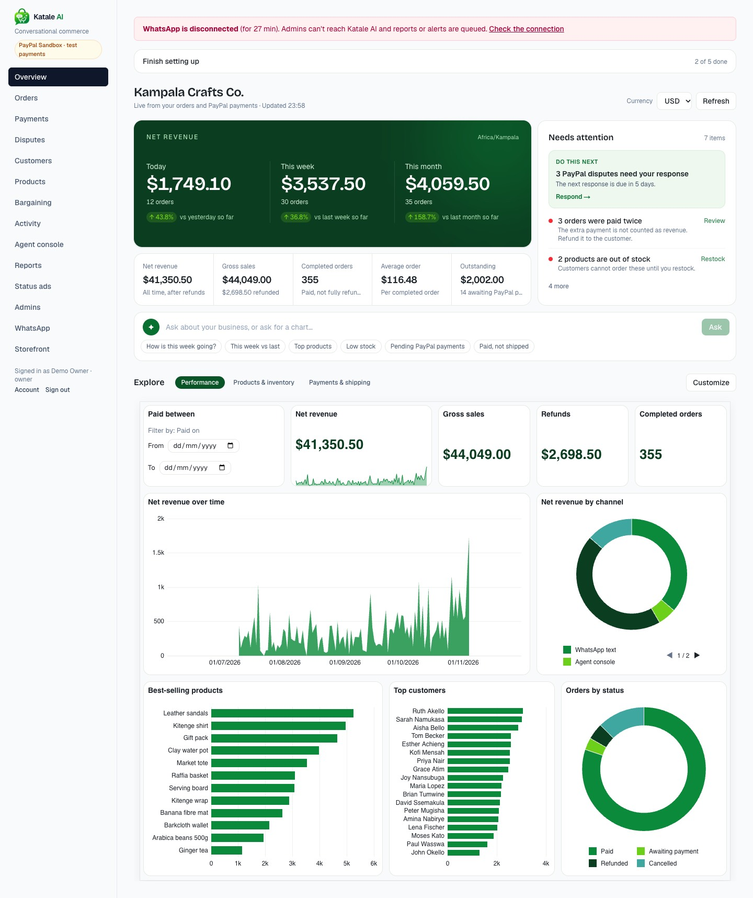     | 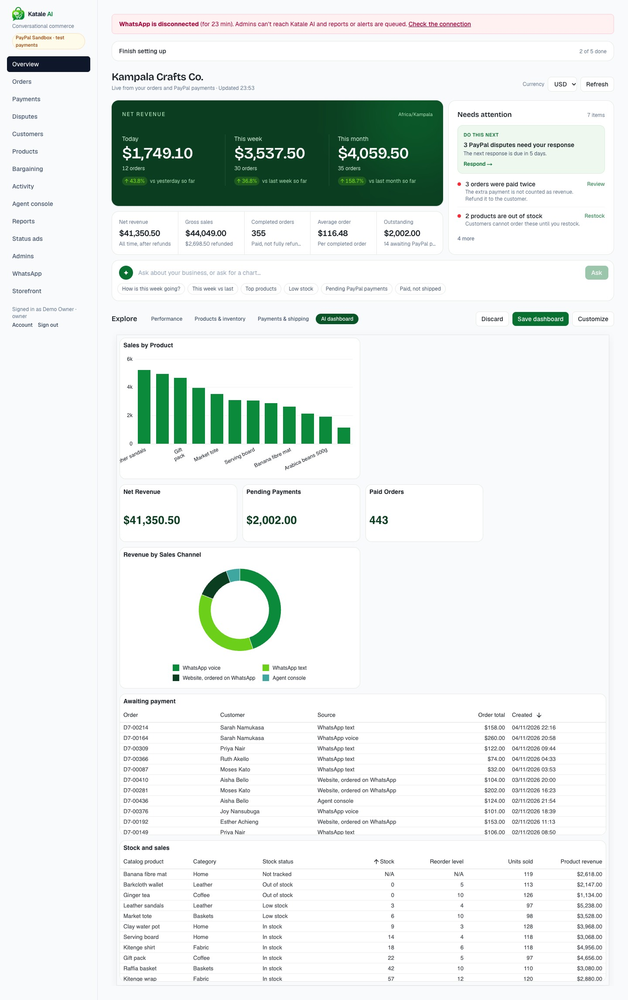   |
| 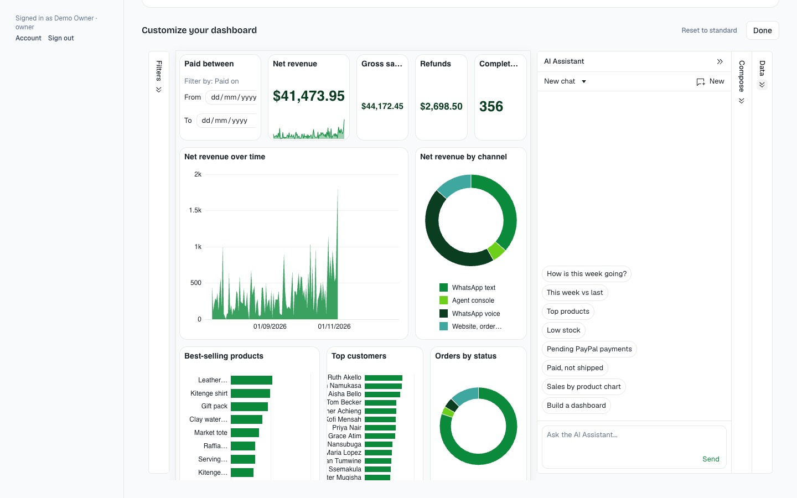        | 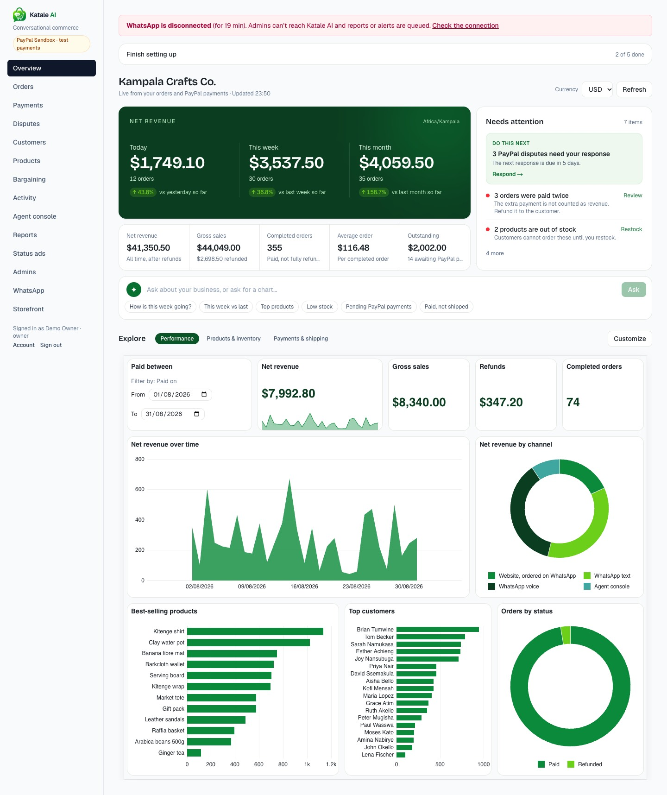     |
| 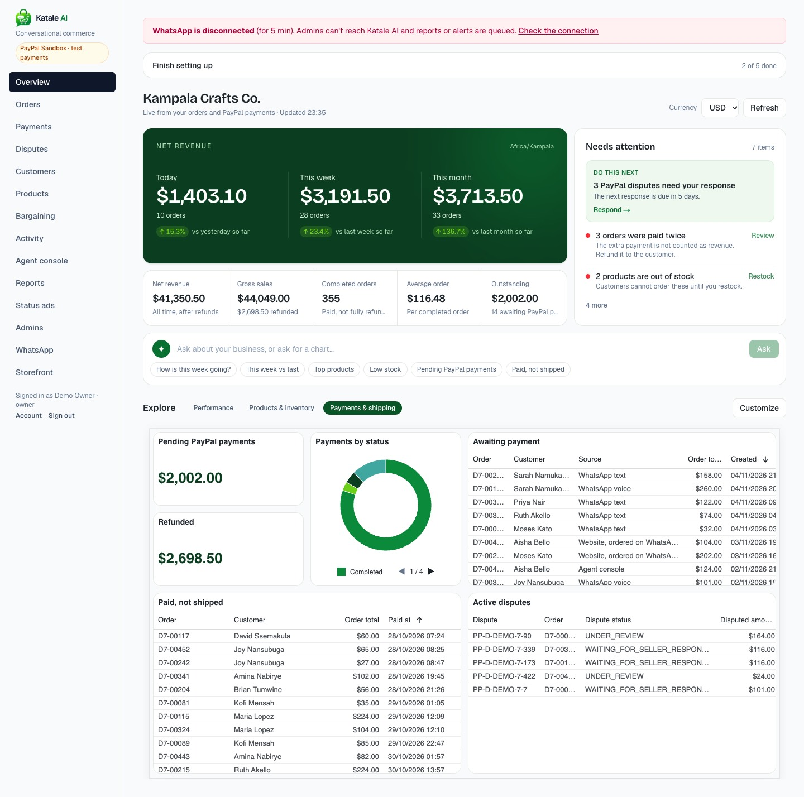 | 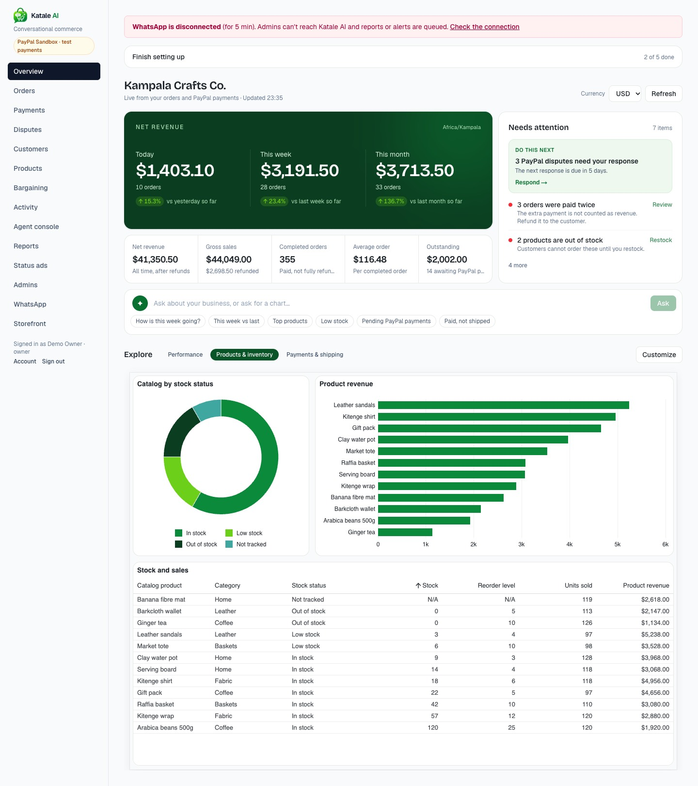 |
| 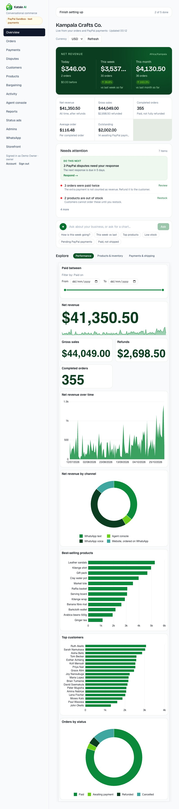         | 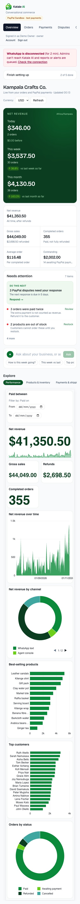           |
| 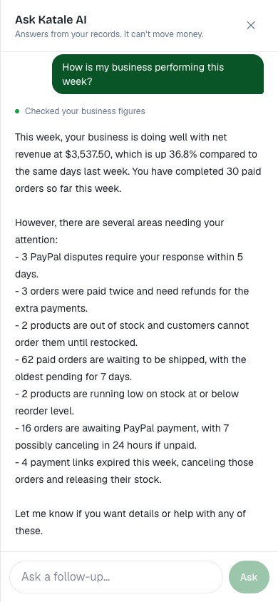 | 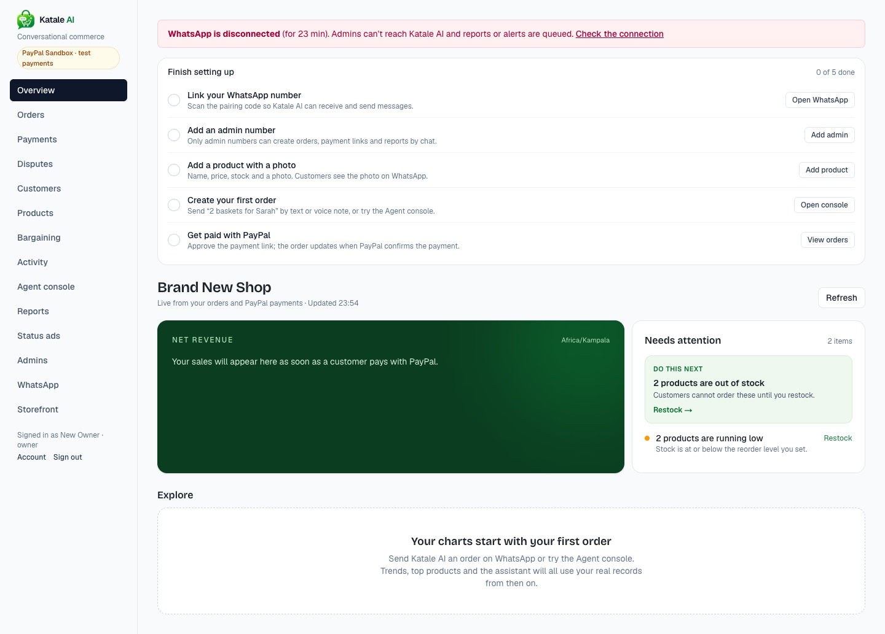            |

## 8. Deploying

### Licence key

1. Request the free 45-day trial at <https://www.ag-grid.com/studio/react/enterprise-licence/>. It
   removes the watermark and console warnings and is allowed in production. Mention the PayPal AI
   Hackathon, and ask whether the licence covers the judging period and which edition it unlocks
   (Studio reports "AG Studio Pro with AI"). The console notice also gives info@ag-grid.com.
2. Check the key with the validation tool on the
   [licence install page](https://www.ag-grid.com/studio/react/licence-install/).
3. On the VM, set it in the deployment `.env` (never in git):
   `AG_STUDIO_LICENSE_KEY=<key>`. The web server reads it at runtime, so no image rebuild is needed,
   and `vm-deploy.sh` recreates the container with it. It is sent to the browser, as AG Studio
   licence keys are, so it isn't a secret like `AI_API_KEY`. Keep it out of the repository anyway.

The trial lasts 45 days from issue. Note the end date: renew or buy before then, or the watermark
returns.

### Release

1. Merge the PR once CI is green.
2. From `main`: `KATALE_IMAGE_NAMESPACE=yigagilbert ./scripts/release-images.sh`.
3. On the VM: `./deployment/vm-deploy.sh <tag>`. It backs up, then runs the additive
   `dashboard_layouts` migration and starts the services.
4. Check: sign in, confirm no watermark and no licence notice in the console, ask the assistant
   "Which PayPal payments are still pending?" and compare the answer with the Payments page. Then
   open the storefront, which ships in the same release.

Rollback: `./deployment/vm-deploy.sh <previous tag>`. The new table is unused by older images.
